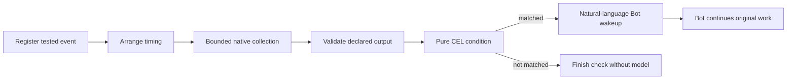

# Architecture

Read [product boundaries](product.md) before changing behavior. Runtime compatibility and
approval policy live in [runtime integration](caelis-integration.md); commands and evidence
limits live in [development](development.md). Source contracts remain authoritative for fields.

## Ownership

```text
native desktop surfaces → internal/desktop assembly → internal/app → backend.Service → adapter → native Runtime
                        ├── bot / eventplan / tasks / notebook / botmemory
                        └── plugins → built-in Desktop World MCP → private CUA worker
renderer → typed product DTOs; no credentials, native IDs or local paths as authority
```

| Owner | Responsibility |
| --- | --- |
| `internal/desktop` | Menu bar, native windows/focus/geometry, OS permissions, capture, input, notifications |
| `internal/app` | Single product assembly, configuration, start/quit and admission fences |
| `internal/backend/api` | Product DTOs and explicit engine/capability ports; host-only ToolConnection stays private |
| `internal/backend/{codex,caelis}` | Native protocol projection, identity, execution policy, receipts, replay and recovery |
| `internal/bot`, `eventplan`, `scheduledata`, `tasks` | Persistent identity, introduction, scheduling, wake budget, delegation ledger and reports |
| `internal/notebook`, `botmemory`, `botskills` | Markdown, embedded Memory and packaged application-scoped English skills |
| `internal/taskterminal` | Owned external terminal application instance and connection receipt lifecycle |
| `internal/machines` | Bot peer profiles, asynchronous connection intents, source identity, frozen task routing and cached observations |
| `internal/plugins` | Reviewed portable packages, built-in Desktop World, immutable installation and runtime admission |
| `frontend/src` | Presentation, transient interactions, character render resources; never execution authority |

`app.Host` injects OS actions. Desktop does not import concrete adapters. Unknown providers fail explicitly.
Optional capabilities are discovered by typed ports and native negotiation, not by text or animation.
`internal/desktop/assembly.go` constructs the sole `app.Application` and service
bindings without Wails/cgo. The macOS runtime owns Wails/AppKit windows, lifecycle,
restart, clipboard, native permissions and updater. `app.Host` supplies small
effect callbacks; `internal/secretstore.Store`, `localipc.Endpoint` and the
terminal script boundary keep OS authority local to their consumers. Frontend
feature DTOs distinguish supported, available, enabled and permission state;
permissions never overwrite a saved product choice. Unsupported hosts fail before
writing preferences. Windows drivers now implement the same assembly with WebView2,
current-user Named Pipe/SID validation, private ACL FileStore and owned Job Objects.
The FileStore remains the current credential contract; it is not Credential Manager.
Windows GUI and release acceptance remain separate gates in the adaptation plan.
Shared-core compilation and native Windows CI do not prove Windows GUI behavior.
Runtime activation replaces the resident adapter inside the same application.
User model selections first enter a host-owned, durable last-choice journal,
independent of setup/network locks. A cancellable coordinator applies them with
bounded backoff; storage failures retain an explicit in-memory saving state.
The settings surface reads this small journal independently of Runtime catalogs,
keeps cached choices usable during refresh, and distinguishes saved from applied.
Model preferences affect subsequent execution; existing turns retain their
native execution snapshot and approvals. Cross-provider conversation handoff
reconciles its original pending send internally while the current connection
remains usable. Worker activity never gates a user's preference.
Admission pauses while the target connects; only a successful handshake commits
the active selection. Failed activation restores the original adapter and draft.
Existing task routes and the independent worker default keep their original
provider. Native windows, the menu bar and the Bot identity stay alive. Only first
activation carries unsent attachments into an empty target; ordinary switches and
rollback load the original provider-scoped selection.
Onboarding preparation keeps a process-local, 30-second setup snapshot. Explicit
recheck and connection mutations invalidate it; executable/preferences/auth-file
changes, a closed Codex management client, and Caelis Host/configuration changes
prevent reuse. No credential contents enter the snapshot. Bundled service preparation
and resident activation share Core's existing recovery coordinator. An unchanged,
ready resident activated by this setup controller can be reused without rebinding
tools or rebuilding plugins; ordinary switching, admission and rollback remain intact.
Confirmed model selection may advance the renderer to extras/introduction while
activation runs. The first introduction still awaits activation and native readiness;
changing pages cannot submit work or turn stale completion into authority.
Inactive Worker observers are detached before reading their ledger into a new
resident. The outgoing resident remains the single Worker owner until commit,
then detaches without interrupting native execution. Failed handoff restores the
original connection and draft; no ordinary Codex Close is used to stop Workers
as a side effect of a settings change. Caelis preference retries reconcile the
original configuration receipt and read back state before issuing a newer write.
Retained Worker approvals remain visible to the current Bot and chat surface;
decisions and external approval navigation route to the exact original adapter.
Worker approval revisions refresh chat even when the resident has no new events.
`GOWORK=off`; no sibling private imports.

The chat and connection settings reconnect buttons use the explicit native
recovery action. It captures and checks the current owner fence, preserves a
confirmed lost owner's receipts before starting a replacement, and never
replays old work. Automatic/setup connection remains observation-only for a
lost owner; an unverified process identity cannot authorize replacement.

The macOS bundle carries a pinned public Caelis CLI in `Contents/Helpers/caelis`.
An explicit CLI override wins; otherwise discovery uses this app's helper before
PATH. The app never overwrites a global CLI or creates a separate Caelis Store,
authentication, model configuration or service authority. The embedded CLI is
updated only with Bot, signed inside-out with the app and covered by its notary
submission. Version/source/archive pins and the upstream license travel with the
bundle. Damaged embedded payloads fail visibly without an ambient fallback;
settings and local chat history remain available.

On connection, the embedded CLI is offered through public `service start`.
Core owns compatible busy-Host reuse, deferred idle replacement, exclusive Store
writes and older-client non-downgrade. Bot coalesces requests using its existing
recovery coordinator and then negotiates the discovered endpoint normally.
The CLI release pin and consumed OpenAPI pin are distinct; distribution version
equality is never a connection requirement. Packaging stages the pinned CLI for macOS arm64, Windows amd64 and Linux
amd64/arm64. Linux uses the complete managed bundle and a systemd user launcher;
this does not add Linux desktop or imply native Windows GUI acceptance.


The General settings login switch reads macOS `SMAppService.mainApp` through a
native desktop adapter. Registration and approval status is system-owned,
separate from product feature preferences and permissions. A login launch skips
only automatic first-run window presentation; the normal menu bar, pet, single
instance owner and original-ID recovery still start. Unimplemented platform
adapters report unsupported without a writable switch.

Codex worker execution, saved task receipts, terminal observation, and Bot
subscriptions have separate lifetimes. A terminal turn starts a short Bot idle
grace; the adapter then uses read-only `thread/read` to confirm the exact last
turn and native idle state before calling `thread/unsubscribe` on its own
connection. The App Server retains the loaded runtime until its own
no-subscriber/no-activity grace expires; another client's subscription or a
running turn prevents that unload. Neither path archives history. Reconnection
reads unresolved workers without loading completed historical tasks; explicit
continuation resumes the same native thread and request ledger. Diagnostics
distinguish Bot subscription retirement from later native `thread/closed` unload.

Whole-owner shutdown accepts an exact native missing-loaded-child error only
after a fresh read of that original child confirms `notLoaded`, a terminal last
turn matching its retained task, and no active work, prompts or uncertain receipts.
Connection, child revision and task identity are fenced across that read. Explicit
Stop targets, partial terminal listings and process/tool cleanup failures remain
unconfirmed. This permits an ordinary restart after native idle unload without
treating arbitrary `not found` errors as success.

After explicit lost-owner recovery, the new connection may read original persisted
Worker history by its retained thread ID. It cannot resume that archived execution
owner, send input or settle its unknown receipts. Reads fence the connection and
task identity, page native messages, and reject missing/partial archived history;
they neither fabricate empty success nor recreate the task.

Worker viability is not a persisted Bot state. Both adapters ignore legacy
`retired` fields and normalize legacy `unavailable` caches to `unknown` on load,
retaining task/session/thread bindings, original request receipts and report IDs.
The next normal atomic save omits the obsolete flag. No migration dispatches
input, starts a session, resumes a thread or rewrites a native owner.
An explicit read addresses the original Runtime with a deadline and fences the
result against the connection generation, binding and newer projection. A native
permission/missing/archive/closed error is an operation result, never a permanent
Bot prohibition. `notLoaded`, completed and interrupted turns do not end a Worker.

Activity and effect receipts are separate. Fresh native idle can release an
unknown execution's possible capacity; an unknown submit still blocks new Bot
input. Accepted input awaiting its own turn keeps a reservation; an older turn
cannot settle it. Activity is transient, cleared on an actual connection replacement
or a new dispatch; ensuring the same ready connection preserves existing evidence.
Caelis reads its original operation journal without re-POSTing; Codex reconciles
its original run/client message identity. Explicit stop intent and unknown stop
receipts survive. A settled stop for an older turn does not prevent observation
of a later explicitly started turn; a current or unknown stop still fences it. Historical callback schemas/digests remain unchanged; a legacy
retire call without an existing receipt now returns unsupported with no effect.

The existing connection observers bound unresolved reads and stream retries.
Caelis maintenance allows three attempts with backoff per Worker, original
operation receipt, or resident/configuration observation; one exhausted object
cannot starve another. Native approval dirtiness requires an authoritative read
even with a healthy stream or terminal task turn. Remote observation has the same
bound per machine/runtime. Healthy active streams/remote work continue to update.
Native progress and explicit user recovery/read renew only the relevant budget;
a successful explicit machine inspection does so even when an older poll is in
flight. Failed reads clear activity evidence in both foreground and background. Codex failed child observations
wait for an explicit recovery/read or new connection; unsubscribe failure waits
for fresh evidence. The quiet connection supervisor also has a finite budget.
The existing host recovery flight renews observers only for explicit recovery;
routine Connect/Ensure calls do not refill exhausted reads or clear idle proof.
Budgets are transient observation counters, not session owners or lifetime flags.
Historical cards do not trigger background resume. Opening a terminal is an
explicit user action: Manager first reads the original binding, then delegates
to the existing terminal owner. Unknown input receipts do not imply a dead
terminal. Original instance, process identity, pending-launch cancellation and
unknown-launch fences remain in `internal/taskterminal`.


The Bot IM transcript is a private local SQLite message log for visible user,
assistant, control-receipt and completed Artifact-bearing tool messages with
stable request/item identities.
Authenticated channel input is recorded at ingress, and native accepted inputs
update that record by request ID; a marked-secret control answer is represented
only by a filled-state placeholder. Runtime live output is appended to the same
log. Chat reads this local transcript instead of importing Runtime items on read.
It loads a 200-message window and explicitly pages older **local** messages, including while
the Runtime is offline. Streamed text updates the same item; only projected
Artifact handles and a tool's visible label enter chat, never native tool
payloads or file-change activity. Desktop actions re-resolve each handle through
the backend before preview, opening, copying or saving; text previews are read
on demand and bounded. Text opens in a dedicated, opaque native preview window;
the filename and compact file actions live in its AppKit title bar. The renderer
receives only the owned handle and safe filename, and Markdown is rendered
without loading embedded remote resources. Disk failure retains the
live cache and retries independently;
a corrupt display database is preserved as a damaged copy and rebuilt. Runtime
sessions, execution state and original action receipts stay with their native owners.
Codex assistant links to files outside Work can promote a temporary file into
an attachment only when a native activity already bound that exact regular
file as an Artifact; a model-written absolute path alone does not grant access.

Codex connects with `thread/resume(excludeTurns:true)`, reads execution metadata
with `thread/read(includeTurns:false)`, and optionally synchronizes one latest Turn
through `thread/turns/list(itemsView:summary, limit:1)`. It never requests full
history or traverses past Runtime sessions. Optional display sync failure does not
block connection or input. Worker observation uses the same lightweight path and
retries separately; a failed Worker subscription cannot detach the resident observer.

Wire projection drains tool output and inline image bytes before JSON decoding or
queue admission. Native approval schemas, scopes and decisions remain intact.
Approval projection also identifies the native owner: resident conversation and
its blocking children share one gate, while only a confirmed independent task
approval may coexist with resident Telegram typing. Missing owner stays blocking.
The 8 MiB projection bound is an allocation safeguard for a single projected value,
not a Runtime/Worker history limit. A completely drained oversized value fails only
its correlated read/display operation; subsequent approvals, completions and RPCs
continue on the same connection. Partial/invalid framing or notification queue
exhaustion restarts only that observer, retaining original owners and uncertain
receipts. Queues remain bounded (512 events, 16 MiB); fast reconnect uses finite
backoff, followed by quiet periodic retries. Started frames have a bounded parsing
time while idle connections can remain open.

Control snapshots use immutable caches, so slow component disk IO cannot hold
status reads. Native control admission has context deadlines; local atomic writes
have a bounded wait and never claim durability after a timeout. Logging has its own
bounded best-effort queue. Optional feature assembly runs after native surfaces are
ready and retries without quitting the application. Invalid native identities or
receipt journals are preserved and reopened after repair; they never authorize
replacement owners or uncertain-effect replay. Window rendering failures remount
presentation independently of native work and other windows. Account catalog reads use three bounded attempts,
including unavailable, empty and missing-choice results. Exhaustion ends loading and preserves Back,
feedback and retry; retrying this catalog never repeats a connection mutation. Composer cleanup observes
original receipts and drafts automatically with a finite budget, never resending a message.
First-run and artifact reads also use bounded recovery; settings, approval and preview surfaces keep
exception text out of presentation. Local retry preserves mounted inputs and cannot submit an enclosing form.

Telegram checkpoints each received update and its original input in a durable
inbox before advancing its polling offset. Callback, control and ordinary-input
lanes are independent, so recovery, inference and downloads cannot stop polling or
`/status`. Callback receipt feedback precedes disk/native waits and grants no
execution authority. Approval claims remain durable-before-dispatch; their original
cards converge to submitted, uncertain or terminal state. Reconnect completion and
failure have explicit feedback. An unavailable Runtime keeps original messages
queued for admission after recovery. A quit/sleeping Mac still cannot receive them.
Unpaired Start hints and candidate acknowledgements share the normal output
`retry_after` cooldown. They allow one attempt per five seconds overall and one per
chat per 30 seconds, with 32 fixed in-memory slots and a one-second send deadline.
Suppressed or uncertain hints are consumed without automatic replay. Nonce
validation and candidate binding precede feedback admission; confirmation remains
an explicit action in settings even when no Telegram hint can be sent.

Caelis display recovery requests one recent Turn, preserving its exact cursor and
command evidence. Stream and Worker failures retry independently of the resident
connection; original commands/callback receipts retain their native recovery rules.

Shared Runtime recovery first reconnects the original owner. Only a failed
standard Codex socket with retained native daemon PID records whose processes
are confirmed absent can call `codex app-server daemon start`; the endpoint
pins the original `CODEX_HOME`. Live/reused PIDs, startup reservations, permission
errors, unknown record formats and private endpoints cannot authorize startup.
For a selected Caelis Runtime with a saved original Store, Store ID and principal,
Bot reconnects first and uses public `service status` after a connection failure.
Only `stopped` permits `service start --store-dir` for that saved Store, including
after a separate explicit `service stop`; `running` handshake, credential and
configuration failures do not restart it. Native start retains its version
selection/upgrade and concurrency semantics. Bot never calls stop/restart or
owns the shared process. Reconnection still verifies the original Store and
principal before accepting the Host.
The manual installed-version action uses the public service status when an old
discovery record cannot be reached. Only a confirmed `stopped` result skips the
live-work preflight; the native start and fresh Bot handshake still follow.

Observers merge startup by shared service directory in one process, with a
30-second cooldown after each attempt, including failures. Startup has its own
30-second deadline; canceling one observer ends only that observer's wait, and
an already dispatched public start may finish. Clean Codex daemon shutdown
removes PID records and leaves startup unconfirmed. Codex retains in-memory
absence evidence after an authorized start because native lifecycle can remove
stale PID records. Caelis needs no discovery or in-memory stop-reason evidence
once the original Store/principal binding is saved and public status is `stopped`.
A successful handshake restores observation and original receipt checks, never
uncertain input, native turns, tools or approvals. It does not prove that
in-flight work survived.

Caelis callback recovery reads the full receipt snapshot once per connection /
stream generation, including claimed calls. Subsequent reads use the native
pending-call wait endpoint, with a 45-second cancellable idle wait, instead of
polling completed tool payloads every 250 ms. The effect still runs only after a
confirmed claim; unknown claims and original result receipts retain their recovery
semantics. A retired connection cannot dispatch a response from its old wait.

## Telegram companion chat

`internal/textchannel` is the shared text baseline for companion ingress and
egress. The paired transport authenticates the owner and persists its original
message before calling the common controller. Pending native approval/question
catalogs receive durable `A`/`Q` numbers and immutable ordered option IDs. A
compact approval card lists `[1]` with the native label unchanged and ends with
`提示：发送 /approve A7 + 选项标号`; the scope remains in the immutable native
catalog and is not appended to the label. `/approve A7 1`
and `/answer Q3 2` use exact current native targets; an answer's nonnumeric
tail is passed verbatim only when that question allows free text. Each native
request keeps its immutable option catalog while its short
reference is active. `A1`–`A999` and `Q1`–`Q999` use separate persisted ring
cursors: pending and uncertain references keep their slots, settled references
return to the tail, and unanswered references expire after seven days. Expiry
releases only the local short reference, never decides the native request; a
still-pending native request can receive a fresh card. A copied bare command
with a recycled number addresses the new request by design. Transport message
references retain their original native binding and cannot authorize a newer
request. The Runtime still validates the original owner and exact option ID.
Each field of
a native multi-question request gets a separate `Q` number. Answers can be
changed before submission; required fields trigger exactly one decision for the
original native request when complete. Multiple selections use comma-separated
indexes such as `1,3`. Simple number/integer/boolean fields are parsed locally;
the native adapter performs final constraint validation. A fixed approval's
custom opinion is feedback, never permission or an automatic Bot handoff.
URL elicitation displays the original HTTP(S) link and every offered native
decision; opening the link is not treated as completion. Loopback, `.local` and
private IP links are labeled as potentially unreachable from a phone. A browser
login or macOS TCC prompt may still require that service or the Mac itself.
Requests whose Runtime offers no usable field values or decision IDs cannot be
invented by the text controller. The controller writes one native decision claim
before dispatch; unknown results remain fenced to that original request.
Codex `request_user_input_async` is a different shape: it emits a completed
assistant item with `delivery=async` and ordered question metadata, not a
pending native approval request. Bot stores a `Q` number for each exact item and
field, mirrors a text card, and sends an answer as a new user input with Codex's
structured question-reply envelope. The local transcript retains the user's
visible `/answer` body, not the internal envelope. A send receipt confirms input
admission, not that the model has consumed the answer or resumed an old turn.
These references are fenced to the original Codex thread and item schema and
are never reused after an uncertain send. Codex async questions have a separate [24-hour lifecycle](design/async-question-lifecycle.md):
answer, dismiss and expiry are durable and cached IM cards resolve against that ledger.
Closing supplies no answer or authorization. A host clock expires them offline.
Closures are local interaction state: they never steer a Worker or enter later
model input. Worker start/continue receives the submitted prompt unchanged. `bot_interactions` can present the original Worker question directly, with
one shared answer/close state and its task source. Native approvals keep the
seven-day short-reference policy above; it never approves or closes their request.
Codex async questions have no native
secret-field marker; the host cannot infer one from question prose.
Known async answers use their ordinary visible input. A missing or stale field
binding remains private, with a neutral hidden-content placeholder; only a real
native secret marker may label an input as a filled secret field. Retained secret
number tombstones continue to hide potentially stale values after number reuse.
Worker answer outcomes belong to the exact message receipt, never the previous
task's display status. An owner can explicitly prove a fresh message was not
accepted; a failed lookup of an earlier dispatch remains unknown and cannot
authorize replay. Expiry discovered at submission is committed and published
before returning, only while the field has no dispatch claim.
Independent Codex Workers persist their async question items under the original
task binding. The host reports the pending question privately to the resident
Bot, which reads it through `bot_interactions` and can answer on that original
Worker receipt path. If information is missing, the Bot asks the user in normal
chat. Ordinary Worker transcript messages and automatic-review facts do not
become user-facing question cards.
For native Worker approvals, Bot may choose an exact offered option on the
original request only when operation, target and scope are inspectable and no
marked-secret field, URL, opaque diff or rule payload is present. Those other
requests keep their original user-facing native card. The resident Bot's own
approvals always remain under Runtime Auto-Review or the user's direct decision.
Each pending coordinatable Worker request produces at most one private host
report; dispatching and unknown report receipts are never replayed as a new
request. The user-facing native card is hidden only after that private report
has an accepted receipt; an unavailable or uncertain report leaves the card
visible so the original request can still be handled. The original Runtime
still validates every decision and resolves it. Caelis currently projects the
native tool-call input as opaque `Details`, so its Worker approvals retain the
direct card until a typed, safely inspectable operation/target projection exists.
Telegram buttons invoke the same controller. Only an inbound reply containing
a transport-supplied reference to a Bot card with a confirmed outbound message
ID can bind a bare index or custom question answer. The binding is persisted
against that card's original request and schema. A multi-field or otherwise
ambiguous card requires the full command; an unbound bare number is ordinary
chat. Quoted body text and the most recent approval are never authorization.
An ordinary reply keeps the original user body in `Submission.Text` and carries
available older-message text as a bounded, channel-neutral quote. Codex
text input and Caelis prompt/steer input receive an XML-escaped `<reference>`
block, a blank line, and the unchanged current body; their visible user-item
projection removes this model wrapper. The host preserves quote line breaks and,
above 4,096 Unicode characters, keeps the first 70% and last 30% with an exact
middle omission count. Transport author and excerpt metadata stay internal; no
extra note is inserted between the reference block and the user's new text.
The Mac chat context menu writes the same quote into its durable local draft.
The IM record stores the original user body and a separate bounded quote for a
collapsed preview; opening the preview never resolves a control request.
Older records without quote metadata cannot be reconstructed. Local chat timestamps come
from persisted message times and are grouped by local day or a five-minute gap.
The first visible message has no divider. A local send decides its time boundary
with the optimistic message before the first paint; exact-request acknowledgement
keeps that display time and boundary stable. Late timestamp enrichment must not
insert a divider above an already visible row. Loading earlier history can add
a boundary at the new adjacency. Draft reconciliation stays silent while work
continues; send preparation uses the existing action button without adding height
or replacing an available Stop action.
Runtime-marked secret inputs and quotes of those inputs are not put in ordinary
model context. Quote metadata grants no permission and does not imply a second
Bot conversation or a transport-aware Bot.

`api.Question.Secret` is a native field marker, not content classification.
Marked answers bypass Bot Submit, ordinary chat history, mirrored text and
control receipts. Secret answers waiting for sibling fields live only in memory;
after restart the owner must re-enter them. Weixin and Telegram persist redacted
ingress records with original message IDs and `Q` references, then reconcile any
unknown dispatch from the original claim. Operation, target and native scope
remain visible; unstructured detail text is suppressed for marked-secret
requests. Arbitrary approval payloads cannot be automatically scrubbed, and
delivery through TG/Weixin exposes plaintext to those providers. The original
Runtime/elicitation service may pass the native answer to a model; this host
cannot promise otherwise.

Desktop, Telegram and Weixin project one Bot conversation. Each companion has
its own durable delivery ledger. Telegram mirrors visible conversation items;
Weixin sends only output attributable to its exact accepted input/Turn, including
batched progress, actionable cards and the terminal reply. Unbound or mixed-origin
Turns are not pushed to Weixin. Routine accepted answer/decision acknowledgements
stay in the
controller's durable deduplication ledger without consuming another IM or phone
message; a later stale command still receives its actual state. The desktop
chat shows async questions as native choice buttons or a free-text field backed
by the same short-reference controller. Pending approvals live in a separate
numbered action tray and disappear when no longer pending, so they never follow
the working indicator as a late chat bubble. Original ingress IDs suppress the
source transport's user-message echo. Telegram may label other-entry inputs as
User; Weixin omits them. A failure in one sender does not block the other's ledger.
Initial pairing and legacy Weixin records baseline the current history instead
of replaying it. Host task wakeups and automatic review progress stay internal;
the Bot's subsequent visible response follows each channel's delivery policy.
This is a snapshot projection, not a separate Bot session or a general event bus.
The first accepted or unconfirmed `bot_delegate` start emits one durable,
user-visible conversation item with the task title (or a shortened prompt). It
is mirrored to Telegram and to Weixin for a Weixin-owned Turn; Weixin emphasizes
the title with Markdown,
without a second explanatory sentence. The desktop shows a compact
chip on the desktop. Stable request replay emits no second item. Ongoing Worker
status and terminal output remain in the task dock; completion reaches chat
through the Bot's visible response. This is not a full task-status mirror.

`internal/telegram` mirrors one paired private chat through pinned Telego. It uses
native `backend.SubmitRemote` and the existing resident submission, interruption,
approval and artifact ports. It does not add transport information to Bot context
or change conversation identity. Desktop drafts and attachment selection remain
independent. Bot tokens use the shared private local credential store; pairing requires a short-lived
link and desktop account confirmation. Polling cursors, original input outcomes,
Telegram message IDs and text digests are saved privately. Uncertain creates and
inputs are never replayed; streamed edits are coalesced and rate limits respected.
Only approval deliveries retain bounded original card text in the private
Telegram ledger, so a terminal edit can keep its request after recovery. The
edit reuses the original message ID, removes buttons, and appends a decision
label only when the original native request resolves with a correlated selected
response. A resolution without that decision remains neutral.
Approval buttons use the same `api.Choice` values as the native panel: provider
`Label` remains literal, while Bot-owned `LabelKey` resolves through the shared
display catalog. An unreadable or ambiguous choice leaves the entire approval
keyboard unavailable and directs the user to the Mac. Telegram callbacks require
the original delivered message, a current pending approval, and an offered choice;
the durable decision claim prevents a second native submission.
Telegram's `ReplyToMessage.MessageID` is accepted only when it matches one of
these confirmed card deliveries in the paired private chat. Marked-secret
answers in its durable update queue contain only a prompt marker; plaintext is
held in memory until the original native decision or a restart asks for re-entry.
The Telegram adapter renders mirrored Mac user items with a source heading and
quoted body. Each long Mac user-message part carries its heading and UTF-16 entity
ranges. Assistant replies retain their plain original text, including edits and
long-message parts. Display labels never enter Bot input or change native request/
item identity. Existing plain-text delivery digests are honored so a formatting
upgrade does not republish history.
Assistant Markdown uses native `sendRichMessage` with `rich_message.markdown`.
Messages containing raw HTML syntax use escaped `sendMessage` HTML so literal
model text is not consumed as markup. An explicit format or method rejection
can also fall back to `sendMessage` HTML,
then exact-source plain text only after an HTML format rejection. Stream edits
keep the original Telegram message ID. Authentication, chat,
permission, rate-limit and unknown network results do not change send format.
Local diagnostics record only API method, numeric Bot API error code, a locally
classified reason, and a fingerprint of the original delivery key with its part
number. Telegram descriptions, chat IDs, tokens and content are not logged.
Previously journaled definite rejections remain recorded and are not
automatically backfilled after an update; the Mac transcript holds their text.
Backend recovery establishes native input authority before remote input is
accepted; local display history is independent. One cancellable output worker coalesces snapshots independently of input
and control actions. A separate cancellable worker sends Telegram typing actions
only while the connected main Turn is sending or working. It renews at a bounded
rate, stops for unresolved approvals, uncertain or terminal outcomes and disconnects, and
does not persist actions as conversation history or receipts. Rate limits and
transport failures cannot delay input, decisions or recovery. Configuration
changes join both workers. Attachment identity
uses the submission and attachment index, preserving distinct same-named files.
Static stickers use their downloaded image bytes. Animated and video stickers use
the Telegram thumbnail as one explicitly labelled frame; a missing or invalid
thumbnail is a rejected input, never a claimed understanding of the animation.
The adapter supplies ordinary Bot image input and retains the original Telegram
message request ID, receipt and no-replay rule.
Host task and command completion reports enter through `SubmitReport` as internal
inputs. Codex persists their exact client IDs in the native binding and imports
delivered or uncertain IDs from the existing native product task ledger before
history projection; Caelis persists `application_summary` in its command
journal and correlates the canonical turn. Both project the input as `hostNotice`
through live updates, reconnect and older history. Presentation and Telegram
skip that kind before reading text or attachments; the subsequent assistant
result remains visible. No prose pattern or renderer-supplied flag establishes
this source. Unknown command admission fences uncorrelated input until the
original receipt identifies it.
Approval keyboards use the pending native option IDs and the Telegram message
ID that carried them. A text-only approval gains buttons by editing that same
message when choices arrive. The first callback claims the original approval
durably; later callbacks, stale message IDs and unknown decision results fail
closed. The native head and option check remains authoritative. Recovery
baselines terminal status notices; a lifecycle notice is tied to its original
user receipt in the current Turn so an old receipt cannot label new work.
The native macOS proxy resolver executes automatic configuration through CFNetwork,
honors the ordered system candidates and cancels PAC work with the HTTP request.
Failed or stalled PAC resolution continues to subsequent system candidates; DIRECT
is used only when explicitly present in that list. A PAC attempt has a three-second
budget, independent of request cancellation. Exhausted candidates report a network
failure. App-level DIRECT retains OS routing, including third-party TUN proxies.
This selection happens before dispatch and does not replay uncertain HTTP writes.

## Weixin private channel

`internal/weixin` is a Go adapter for the published Tencent iLink JSON client
protocol, pinned to the inspected `@tencent-weixin/openclaw-weixin@2.4.9`
source. It shares the resident `backend.SubmitRemote` path with Telegram and
keeps its own private cursor, owner-bound inbox, original ingress outcomes and
outbound chunk intents. The shared private local credential store separates
Weixin, Telegram and plugin tokens into namespaces under `Credentials/`.
Existing Keychain items migrate on first use and are deleted. Pairing QR state lives
only in memory; settings starts or refreshes it while visible. Start/stop
presence and disposable typing requests are independent of message receipts.
Only owner private text and output traced to Weixin-owned work are in scope.
Outgoing files use the same Host-owned Artifact resolver as Telegram. The
adapter accepts only projected Artifact IDs, bounded regular files and safe
filenames, then requests a FILE upload URL, encrypts bytes with AES-128-ECB and
PKCS#7 padding, and POSTs to an allowlisted Weixin CDN endpoint without bearer
credentials or redirects. A successful upload yields one type-4 file item.
File preparation runs away from the polling loop. Its durable `preparing` state
may be retried after restart within the original input window because no
message was attempted. Each file has its own message and send slot. The
original Artifact ID and Turn key one send intent; a new user request can
expose the same owned artifact in a new Turn. Budget-deferred files are terminal
for that intent and never drain into later windows automatically. Final text
keeps safe filenames as readable placeholders. Once the send slot and unknown
intent are saved, no timeout, restart or new ingress replays that intent.
Failures and deferred sends remain visible in Weixin settings. Incoming file
messages and phone receipt remain outside this slice.
The first completed commentary is sent as progress; subsequent completed items
are merged in order after three items or near the safe single-message length.
Progress attempts are capped at five per observed ten-send window. Native
approvals, async questions, Worker-start items and terminal replies have separate
priority; questions may wait when only the final-reply reserve remains. A final
reply may absorb unsent progress from its Turn. `/r` or `/refresh` flushes pending
progress without a model submission; `/help`, `/status`, and `/stop` are local
controls (`/stop` uses the original native interrupt). Each actual text part
reserves one slot in a durable owner/last-ingress window before HTTP; an old or unknown window never starts
full after restart. This is a conservative estimate of observed service behavior,
not a published quota contract. Weixin cannot edit a previous card or prove
phone display from HTTP success. Unknown HTTP outcomes keep their original
intent without automatic replay, because upstream client-ID deduplication is
unproven. The Worker-start presentation carries the original Bot tool call's
projected Turn identity; a native Worker approval carries its exact task ID.
Weixin uses that persisted task-to-source binding instead of guessing from the
most recent chat message. A later host report's original receipt ID resolves to
that same task, so the Bot's resulting Turn retains its Weixin delivery source.
This association travels as private structured snapshot metadata, independently
of the hidden `hostNotice` item. The native adapter retains the exact report,
runtime/conversation, turn and terminal phase across recovery; cached and recent
snapshots preserve it without exposing it to renderer JSON. Native input sources
also retain each item's actual scope: Codex captures the explicit native thread
at projection, and Caelis persists the authenticated feed's instance/session/turn
with the item. Retained Codex messages and Caelis PastSessions keep their original
scope; Caelis also retains input evidence beyond canonical display eviction so
reloading an older page cannot reassign it. Service only carries this evidence
through chat assembly; neither native
nor SQLite display history may inherit the current snapshot owner. Missing
provenance on retained inputs stays unproven across native replay; newly observed
inputs require an exact scoped native observation. The channel joins it
to the persisted original task turn and checks the runtime/conversation scope.
Missing or mismatched provenance fails closed before outbox admission and emits
a bounded `route_source_unresolved` diagnostic with a classified reason and a
fingerprint only. It never falls back to the latest active messaging window.
Ingress and Worker receipts are likewise never replayed; see
[POC scope](weixin-channel-poc.md).

## Remote machines

Bot peers and local adapters implement the same `api.WorkRuntime`. A's existing
`tasks.Manager` owns product tasks, approvals/questions, output/history/files and
completion notifications. B's isolated `NewWorkOwner` executes; its bindings are
not imported into B's resident WorkStates, task list, chat, notifications or Agent.
No remote task ledger, execution manager, recursive delegation or account authority
is added. A never configures B's model/account/Worker preferences.

Connection authorization is asynchronous, in the existing machines profile and B
peer registry. A persists source/proof/intent before delivery, reads public identity,
and durably pins B before POSTing a target-bound request. B's authenticated user
approves/declines the exact request; grant plus decision persist atomically. A
returns on request admission, not human approval, and reads its original request
on page entry/manual Check. Pending peers have no task routes, are absent from
environments and do not enter background health polling. Each direction has an
independent proof/approval. Browser cookies/loopback never authorize peer execution.

The App owns a peer-only listener. Default 9317 falls back to an OS-selected port
on conflict and publishes/persists the actual endpoint. An existing reachable
headless listener is reused; a loopback browser listener is not widened. Public
identity/request endpoints open no native owner. Per-request body/queue/retention
limits and bounded network reads affect only remote features. Corrupt peer state
fails closed locally without preventing the resident, local Worker or ordinary HTTP.
The explicit settings refresh reopens only a failed original registry or prepares
a missing listener; healthy peer identity/owners are never replaced. Local one-shot
UI deadlines expire readiness/request presentation without network polling.

The old SSH/helper executable, installer, legacy credentials editor and
remote-terminal wrapping are removed. There is no experimental-data migration or
old code authorization graph. A new network-only [SSH channel](ssh-connections.md)
reuses standard system/private OpenSSH configuration and the same Bot peer protocol;
Tailscale stays external. No helper execution or second task authority returns.

For established connections, native task routes/runtime/owner/request IDs persist
before execution. Unknown results reconcile original receipts; they never choose
another environment or local fallback. New work may replace only a verified exited
private owner; old tasks/decisions are not migrated. Stop atomically validates its
original operation and expected execution generation inside the adapter.

Network/native operations never hold the shared machine route lock. Late replies
are fenced by connection and binding generations. Local task operations do not wait
for peer polls/cleanup. Stream limits are compensated by bounded full observations;
resource budgets never hide approvals. All interactions retain original native
IDs/choices, including sensitive and opaque requests. A owns their existing UI and
returns decisions to the exact execution owner; B never presents foreign task UI.

Local and peer cards share A's Worker output/history view and scoped file paths.
Remote paths are not A-local paths; verified inputs/outputs use task-scoped bytes,
metadata/digests and the existing storage/cache authority. Retrieved output stays
readable offline. See [implementation](bot-to-bot.md), [UI](remote-machines-ui.md)
and [bounded URL contract](worker-peer-url-contract.md).

## Execution and recovery

Native request/Thread/Session/Turn/item identities remain private and exact. The renderer receives opaque
handles, typed lifecycle facts, and native approval choices. Missing/null/explicit-empty fields differ.
A displayed message, task card, gesture, tool discovery or accepted dispatch never proves execution success.

Persist mutation intent and stable request ID before dispatch. Accepted/rejected/unknown remain distinct.
Unknown operations only reconcile the original receipt; never resend with a fresh ID or switch Runtime.
Early terminal events win over late responses. Main prompt and steer receipt recovery both update the original Composer receipt; scheduled/Worker receipts cannot replace a newer human receipt. Replayed items replace/deduplicate facts; old history pages
cannot replay approvals, create workers or overwrite live state. Callback dispatch uses the original catalog,
configuration revision, tools version and invocation; an unavailable old handler fails rather than rerouting.

Outbox bubbles use client IDs or exact native receipt targets, never matching prose. Rejected/unknown input
retains the draft. Host drafts persist across surfaces/restart but are not an automatic outbox; restoration
never sends. Screen submission has its own durable receipt and cannot consume the composer draft.
Terminal local bubbles stay beside their original history anchor while visible
and retire if bounded Runtime replacement removes it. Image presentation
restores only unknown or in-flight input; accepted/rejected image receipts stay
available for canonical history by original request ID without resurfacing as
new tail messages after restart.
Read-only Composer/Recent snapshots avoid serializing all history; older-page loading does not own lifecycle.
Caelis startup/reconnect requests only one recent Turn. Explicit older-page loads use the existing eight-Turn traversal and merge decided mirror reviews with messages at one persisted boundary. A bounded page failure retains the live cursor, seen watermark, approvals and receipts; historical reviews never become actionable approval targets.

Codex owns only the server it launched. Explicit stop/quit interrupts exact owned work, asks native terminal
cleanup, then reaps that process. macOS descendant fallback uses captured PID plus birth identity; no global
process-name kill. Closing/hiding UI has none of this authority. Shared Caelis Host/Workers survive Bot detach;
Bot neither stops the shared Host nor cancels native workers on ordinary close. Cancellation after dispatch
may leave an unknown effect, which cannot be called “not executed.”
Conversation Stop records exact native targets before a bounded pre-cleanup attempt. A durable prepared state
means no turn interruption was dispatched and permits an explicit retry of those targets; once dispatch is
attempted, reconnect only observes the original native turn and cleanup result. Terminal native status remains
authoritative when a prepared Stop was never sent.

Resident Runtime replacement is fenced by active work, approvals and unknown outcomes, then persisted for restart.
Worker-default changes are live and have no task-state fence; existing tasks keep their native owners.
A read-only check or selecting a settings tab does not change the execution owner. Model/effort/tier changes
may apply to the next native request; directories, sandbox and inheritance are create-time configuration.

## Durable data

Default data is under `~/Library/Application Support/Caelis Bot`; Dev uses `Caelis Bot Dev`.
`CAELIS_BOT_DATA_DIR` selects an isolated acceptance profile. Private state uses same-directory temporary
files, sync and replacement with restricted permissions. macOS rename behavior is not a Windows guarantee.

Bot identity, Notebook/Memory, appearance and product task records are shared across Runtime choices.
Native bindings/credentials and scheduled execution remain provider-scoped; old Codex root files remain
readable, Caelis uses `providers/caelis`. Switching never migrates an unknown operation to another provider.
Caelis Bot and TUI use the same Host principal and credential; Bot keeps no separate application credential. Logs/diagnostic export contain allowlisted
states/counts/versions, not conversation prose, paths, native identifiers, arguments or credentials.

Notebook has `MEMORY.md`, generated `INDEX.md`, historical `HANDOFF.md` from older versions, and local-date `YYYY/MM/DD/*.md`.
Only INDEX is automatically rebuilt; it indexes Markdown paths/titles, ignores hidden directories/symlinks,
and refreshes at startup, before submit and on completion. No background model or body database owns notes.
User edits/deletions persist. Legacy personal data is copied once with a marker outside Notebook; conflicts
stop migration and preserve both sides. No automatic Git commit or cloud sync.

Existing private Memory data and the independent settings capability remain intact, but the Bot no longer
publishes `bot_memory` for model recall or mutation. Bot memory writes now use native file tools on
`MEMORY.md` and Notebook notes. `INDEX.md` indexes paths and titles, not note bodies; search uses file
reads or `rg`. Historical private evidence is not automatically moved into Notebook or searchable there.
Notebook is the resident writable workspace, not HOME; Workers have independent directories and instructions.
Neither scope claims isolation from another process under the same OS user or from full-access execution.

## Bot tool catalog

Bot-owned portable plugin packages and their reviewed source adapter are described
in [plugin-packages.md](plugin-packages.md). Package MCP services do not join the
built-in automatic approval list.

The native resident catalog contains `bot_tasks`, `bot_delegate`, `bot_interactions`,
`bot_schedule`, `bot_schedule_update`, `bot_event`, `bot_gesture` and `bot_dream`, subject to
Runtime capabilities. Desktop World contributes one `exec` tool through its own
MCP server when its built-in plugin is enabled. It is never included in the
built-in automatic approval list. Typed requests use application-owned schemas
and native dispatch validation.

`bot_delegate` takes a prompt and optional original task handle. The Host derives
each durable submission ID from the resident Runtime's native tool invocation;
separate calls with the same text are separate submissions. A retry of the same
transport call may reconcile its original receipt once. A native unknown result
never authorizes a new submission ID or an automatic replay. Creation-only
title, workspace and environment cannot rebind a retained task. `local` means
the Runtime currently hosting Bot; connected remote environments have stable
keys. `bot_tasks` exposes environments, all retained task summaries, native
completed User/Assistant message reads, stop and pin. Creation time is stored
for new tasks; migrated undated tasks retain stable ledger order. Read does not
consume completion notices or start work; unreadable native history is an error.
The desktop watchlist and activity-based admission remain Host internals.

The new catalog never advertises legacy aliases. `bot_memory` is also removed from
the legacy catalog and both invocation paths reject it, including calls through
old MCP service names or persisted tool references. Historical private data stays
stored; prior `bot_memory` callbacks can no longer execute and require an explicit
file-based follow-up if still relevant. Caelis retains the old catalog version
only to settle original non-memory callbacks without granting a retired memory
effect. Private MCP invocations carry a
catalog generation. Caelis restores both the exact previous compact catalog
from `5903254d` and the older legacy schema/policy version for pending callbacks.
Historical memory callbacks remain denied even when their original catalog
digest is recognized. This preserves original receipts without
rerouting them to the current same-name schema or replaying mutations. Unknown
catalog versions still fail closed. Legacy request lookup remains an internal
receipt recovery path; the new model catalog cannot query by requestId or invoke
the retired watchlist/retire schema. Missing or ambiguous original receipts
remain unconfirmed. Worker defaults, native
bindings, approval policies, Notebook isolation and event/calendar grants have
independent semantic owners.

Base replies expose `ok`, bounded native `data`, retained `outcome`, and useful
receipt-based `next` only where appropriate. Large structured replies avoid a
second JSON copy; output overflow retains mutation identity and reports its
budget limit rather than replaying. Task and arrangement lists are paged. Exact large reads use fingerprint-bound,
lossless JSON chunks; calendar summary pages omit full saved prompts. See the
[tool lifecycle audit](bot-tool-lifecycle.md) for bounds and retained evidence. Desktop
receipts/pixels retain the public SDK's stricter projection contract.

## Skills and context handoff

`internal/botskills/skills/` is the sole English Bot behavior source. Install complete directories into private
`app-skills`; only name, description and location enter resident instructions. Body/references are read on
demand through native file tools. Do not install globally or copy the Bot catalog/Notebook into Workers.
The installed bundle is replaced when the application starts. A rebuilt binary
must start before its new bundle reaches the data directory; an already running
Worker retains the instructions and context from its original start.
This is an application-scoped file catalog, projected through the resident Runtime's selected Skill paths.
Update skill guidance for behavior changes; implementation-only fixes need no duplicate guidance.
Codex receives the resident Skill metadata guide in developer instructions. Core uses its selected
`skill_roots` to publish the same metadata in each model request, so Bot does not also append that
guide to Core profile instructions. Both adapters load Skill bodies only on demand.

First introduction is a normal user message with a durable stable delivery ID; until acceptance it precedes
other submissions. The host does not write the Bot personality or claim that acceptance proves memory saved.

The Bot maintains Notebook and `MEMORY.md` during ordinary work. After a batch of
work or a clear goal change, it assesses whether obsolete task detail or unneeded
recalled tools make context redundant; no context watermark or per-turn Dream rule
applies. The gated `bot_dream` contract requires a bounded handoff summary. The
Runtime completes the owning turn before another same-batch effect or model step,
persists the handoff, and starts a fresh internal Session without old context and
recalled schemas. The handoff retains identity and constraints, current goal,
unfinished original task handles, uncertain original receipts, and next action;
completed work is summarized briefly. Idle, Host recovery, and version upgrades
do not dispatch maintenance turns. The retired `bot-dream` Skill is not installed.

The APP keeps handoff data in a private durable record keyed by original call and
source Session, outside the Notebook. The new Session's first accepted Host input
contains current `MEMORY.md` and the handoff as saved context, never as a fabricated
user request or higher-priority instruction. Only durable acceptance consumes the
matching private digest. Normal inbound messages, task feedback, MCP connection
configuration and auth stay with the Bot; old model history and ToolSearch results
stay with the old Session. An unknown creation is reconciled under its original ID.

Legacy `dream-*.json` receipts are read without dispatching another maintenance
turn. A matching completed `HANDOFF.md` may migrate once into the private record;
the Notebook file remains untouched. Rejected renewal continues the old binding.
Runtime tool publication remains gated on an atomic terminal-result contract in
both adapters. A tool result followed by a best-effort cancellation is insufficient.

## Scheduling and native observations

Calendar reminders retain their original store and receipts. `internal/eventplan` owns the single
condition-based arrangement engine, including native observations, scripts, tools and task completion.
`internal/scheduledata` owns bounded pure CEL and native metadata sampling; it has no dispatcher,
authorization, storage engine or interruption policy. `clock.minute`, `desktop.usage` and
`desktop.appChanged` feed the same occurrence queue and receipt path as collected events.
Desktop activity sampling requires a meaningful active-desktop sample, but dispatch never uses
presence as a global gate. No separate care purpose, prompt or engine remains. Lock/unknown data
may be used explicitly by a task's collector or condition; the built-in activity payloads do not
invent a presence variable. Desktop input permissions remain independent.

`save` with a native event trigger is a schedule API, not a call into a retired tool. Stable native
handles map to schedule records; changed definitions require removal and a fresh registration ID.
New native arrangements use schedule grants. Shared event admission defaults to eight wake attempts
per rolling 24 hours and a five-minute gap; explicit `configure` changes that budget through review.
Silent completion still counts as an attempted wake. Calendar policy remains unchanged.

On first opening a provider's event store, a bounded read-only decoder imports `care-<provider>.json`.
Imported definitions retain their original handle, grant ID/version, cooldown, origin requests,
source watermarks and pending expiry. Original activation IDs become occurrences. Removed or
superseded definitions remain terminal records for receipt reconciliation only. `unknown` and
`dispatching` become uncertain wakes, never new submissions. A destination checkpoint and all
imported records commit atomically; after that checkpoint the old file is never read or modified.
Failed migration preserves the old file and disables native registration/observation while ordinary
chat, calendar and existing event plans remain usable. Destination write failure freezes that store.
Old accounting creates conservative one-day reservations; the stricter old/new limit is retained.
Unknown records remain until original receipt evidence resolves them. Migration does not fabricate
channel provenance or renew expired operations.

The old `bot_care` and `bot_care_read` names are absent from current and legacy MCP discovery and
have no executable historical callback binding. Calls return an explicit retirement result with
no effects. Frozen catalog metadata exists only to match unrelated pending Caelis callbacks;
it cannot register or dispatch care work. There is no public event-publishing extension hook.

## Tasks and external terminals

Product tasks own directories, ordering, visibility/locks and finite reports. Native Runtime owns execution,
permissions and worker history. New worker instructions do not inherit resident skills/private tool endpoints.
Reports are application notifications, not new user authority; execution status comes from native events.

A task card owns a dedicated GUI application instance established by LaunchServices completion and PID/birth,
not window title, TTY, foreground state or count. A single controller serializes intent. An existing app returned
by launch is rejected. Open Documents delivers a one-use attach script; its receipt proves command delivery,
not a window identity. Standard Quit waits for actual exit and honors terminal cancellation without strong kill.

A terminal may acknowledge a document after cancelling script execution. After the native reply, allow a bounded
three-second receipt grace, then atomically revoke the unclaimed token; only proven revocation permits explicit
retry. Concurrent claimed receipt wins. Unknown launch retains its pending owner, including a late callback.
A confirmed exited TUI client can reconnect in the same owned GUI instance; do not inject into its old shell.
No automatic reconnect, task prompt replay or idle instance cleanup. Closing a terminal does not stop a Worker.
Hide/show, placement and still preview are optional driver capabilities; unsupported actions preserve ownership.

Windows uses its own console/ConPTY adapter and verified client receipt, while
retaining the same Worker ownership contract. At the final interactive child
launch, remove inherited `NO_COLOR` and `TERM=dumb` from headless parent tools;
preserve genuine terminal capability variables and the allowlisted runtime home.
Task preview geometry is computed in native monitor-relative DIP coordinates;
the renderer paints the bounded fan/side stack without changing task bindings.

Caelis Worker history accepts exact `append_page` continuation cursors before
the final `sync`. SSE IDs must still match their delivery cursor, and only the
completed sync supplies the older-history boundary. Replacement transactions,
original Session ownership and bounded traversal remain mandatory; an unreadable
stream must not become an empty successful conversation.

## Desktop and presentation

Desktop World v0.1.2 is an optional built-in Agent Plugins package, initially
enabled. Bot verifies the pinned slim Plugin archive and BUILD provenance,
extracts ordinary relative files without executing the download, and verifies the
complete inventory, runtime, worker and licensing digests. The package
(`bin/dtw`, `libexec/cua-driver`, `LICENSING/` and its Skill) is staged into the
signed app, which installs an immutable
reviewed copy on first launch or upgrade. A saved disabled choice survives the
upgrade. Bot lists it first as Computer Use / 电脑操控 while retaining the
`desktop-world` package ID. The reviewed icon extension is applied after upstream
verification and included in Bot’s final sealed inventory. The existing
PluginManager and both Runtime adapters project its Skill
metadata and one stdio MCP server; Skill body and CUA API load on demand. Neither
renderer nor model selects the native executable path. Disable and update revoke
previous service generations, including processes retained by old Runtime
sessions. Old `bot_desktop_*` callbacks are retired and absent from the native
catalog and approval list.

The MCP `exec` tool and its private CUA worker are upstream release code. The
v0.1.2 execution context is owned by the MCP process; callers omit a named
`session` and recover receipts through that same originating connection. Bot's
Skill follows upstream Windows DPI/modal-dialog limits and requires UI readback
when an input error may follow an already applied action.
The worker is spawned from the plugin process under Bot's app bundle, without an
installed second app or Node runtime. The current Runtime chain starts the Bot
MCP bridge from Codex or Caelis, then `dtw` and its private worker. On the
signed DevBot, macOS `launchctl procinfo` reports the Bot main executable as
the responsible path for the private Host, bridge, `dtw` and worker. This is
an OS responsibility observation, not an inference from PPIDs or package metadata. The resident Bot holds a kernel file lock in its
private plugin store; the bridge checks it before spawn and during execution,
so a retained Runtime configuration cannot operate after normal or abrupt Bot
exit. Bot's Accessibility and Screen Recording
permissions, Runtime tool approval, CUA's own operation boundary, and native
result/readback remain separate checks. Bot does not silently approve this MCP
server, reset TCC, or infer successful input from a model reply. Published v0.1.2 Mac binaries are Developer ID signed, with upstream notarization
evidence. Bot verifies those signatures before re-signing both nested binaries with its
selected app identity. The
app seals the complete resulting inventory and independently passes its own
notarization and Gatekeeper gates; upstream tickets do not qualify Bot.
Windows package verification and cross-build are separate from Windows GUI
acceptance. The pin, package and permissions evidence are in
[development](development.md); portable format support is in
[plugin-packages](plugin-packages.md).

Native logical coordinates use primary-display bottom-left origin, Y up, including negative coordinates.
Device pixels/DPI do not belong in saved character scale. Chat and settings use
separate retained native windows and WebViews. The top-right settings
entry opens or focuses the existing settings window without hiding chat. Native
close hides only its own window. Renderer navigation checks onboarding, dialogs
and unsaved forms; opening and closing settings preserve the mounted composer,
draft, attachments and chat reading position. Web reuses those components in a
same-page panel and retains its existing URL guard as the navigation authority.
Native sheets remain attached to their originating window. Closing a window hides
presentation without deciding requests or stopping work.

The native attachment chooser owns its pending call until selection or cancellation;
the renderer's RPC deadline does not expire a human-operated sheet. A committed
selection emits a change notification so the current composer reads authoritative
files after a view replacement, without reopening or resubmitting the chooser.
Draft image previews authorize only current opaque selection IDs. Chips use small
thumbnails; an explicit preview open can read validated original image bytes as a
bounded data URL (20 MiB file limit and the existing decoded-image limits). Native
paths and selection persistence stay with the host; previewing never sends a file.

AppKit owns nonactivating panels, hit masks, drag,
focus, Space/display changes and geometry; Three.js owns model/mixer/local poses and GPU resource disposal.
Scaling updates geometry, projection, anchors and hit coverage coherently. Transparent clicks need real OS tests.
The passive bubble owns an always-active AppKit tracking area and forwards enter/exit facts to the
renderer without activating the app. WebKit's key-window hover delivery is not its native trigger.
The renderer retains delayed collapse, bounded scrolling and explicit approval interaction.

Desktop/Dock/ActiveWindow context records freshness/source and unknown/estimated fields; foreground does not
prove task association. Local behavior consumes facts without invoking an idle model. User input and pending
decisions preempt decoration. Independent paper-plane surfaces are bounded/pass-through and reclaimed on hide,
Space change or disposal. Planned movement/intent receipts must not be advertised as current bot_gesture semantics.

Streaming is presentation-only: a continuous 60–120 grapheme/second budget survives snapshot boundaries and
completion, with a capped time step after a stalled frame. New replies remain eligible even when first observed
as completed; arrival tracking is independent of avatar/execution state. Initial/reopened/reconnected history
and prepended pages establish a baseline without replay. Authoritative final Markdown remains exact, and
approvals, stop controls, copy actions and execution state never wait for the text animation.
Raw HTML is disabled and remote images are links, so reading cannot fetch resources.
Reduced motion/history/hidden surfaces display directly. GL contexts own and remove their canvases on disposal;
StrictMode/repeated previews must create fresh renderers and release textures/materials/bones.

Chat portraits consume finished, model-derived sprite atlases from official character contract v3;
they never construct a Three renderer. Only the current reply/work/approval portrait animates;
historical rows use a neutral poster. Typed activity selects thinking, searching, focus, replying,
waiting or Dream clips. A live observed successful turn edge can play one completion clip for six
seconds; opening/reconnecting history, quiet work and failures cannot trigger it. Waiting labels
share the same facts: visible current-turn assistant streaming suppresses tool/thinking dots,
while approvals, reviews and interruption retain their control priority. Completed commentary
does not suppress ongoing tool work. Animation never drives execution or authorization.
Codex recovered agent messages have no native item status; only live item-start/delta events
mark them in progress. An unknown-status recovered commentary cannot hide an ongoing tool.
Completion portrait eligibility expires with its six-second target; reveal-arrival history is
independent and cannot keep a completed portrait animating or revive it in a later tool-only turn.
Caelis projects main-scope ACP text chunks as in progress until an explicit final frame,
new foreground tool/thought segment or turn terminal. Child events and sparse tool updates
cannot end a concurrent reply; resumed text on the same message remains eligible for reveal.
The player keeps at most three cached atlas entries (each decoded atlas at most 8 MiB), loads on
visibility, fences late loads, crossfades through a small canvas and cancels frames on hide,
offscreen and disposal. Reduced motion holds a representative middle frame from the selected
state's atlas and adds a small, slow breathing loop, preserving activity expressions without
playing the full gesture. SVG fallback uses the same bounded breath.
The pet blends slow idle at low weight into its rest pose and retains facial blinking/state
expression, while suppressing large gestures, drag-run poses and props. Necessary CSS status
indicators use a slow opacity cycle without travel/rotation and pause when hidden/offscreen.
System preference changes are observed live; history and explicit custom PNG avatars stay static.
This is presentation policy only; Bot skill guidance and tool behavior are unchanged.

Native screen input owns immutable image/thumbnail bytes and its independent durable receipt; renderer receives
opaque handles. Capture preferences freeze at acquisition; redaction affects both images. Submitted documents
cannot change scope. Ask Bot rechecks negotiated model image support immediately before dispatch. Unknown delivery
never resends; unreadable receipts remain uncertain. Attachment maintenance uses native Trash, protects originals,
selected/active files and symlinks, and never constitutes image resubmission.

Windows snapshots capture state under its mutex, then releases it before calling Wails, creating a WebView,
publishing clipboard data or notifying a renderer. Service notifications also release the product-state mutex
before entering native capture code. A slow capture surface must not block chat/settings reads or the native
message loop. PNG decoding and DIB conversion run off the UI thread. Explicit window activation never attaches
an external process's input queue to the Bot's UI thread.
Windows admits only one F1 acquisition/editor at a time. A second F1 invalidates
pending pixels or dismisses the editor; late paint cannot reveal it again.
Dismissal never discards an exporting or uncertain request. F3 belongs to a
visible full-screen editor even during transient focus loss. Empty prewarmed
WebViews are non-activating and are not replenished during capture interaction.
The interactive screen preview uses a lossless in-memory bitmap through an
opaque, no-store virtual-origin asset route. PNG encoding waits for confirmed
export. Completed editors release their images and destroy their WebView: a
hidden compositor can retain an old selection even after renderer reset. Two
fresh non-activating renderers reserve an editor and its subsequent F3 pin. The
bounded pool is replenished after close or pin readiness, never during editor
interaction or another surface's first paint. No pixels are acquired in advance.
The editor dims the whole image until a selection is confirmed or dragged, then
only the area outside that selection. Export flattens the original pixels and
annotations independently of the presentation mask.
Exporting and uncertain documents retain their original window and request.
If the user closed the surface during export, cancellation or failure releases
its hidden resources once the operation settles. An uncertain send stays owned
until an authoritative receipt arrives; no dismissal causes resubmission.

The optional Extras gate owns only the manual F1 selection/annotation/Ask Bot and
F3 clipboard pin tools. Native admission, Carbon shortcuts, menu commands and
in-flight selection share the persisted gate; disabling cancels admitted sends
and keeps their original uncertain receipts if dispatch already began. It closes
temporary panels without deleting retained chat attachments or capture records.
Re-enabling restores saved child shortcuts and recoverable capture records. The
gate does not govern ordinary chat images or Desktop World task observation and
capture. Screen Recording remains a separate macOS permission; preference reads
and disabling never request it.
First-run feature selection has its own native completion marker, separate from
the legacy permission guide. New installs save the chosen capture gate before marking
the feature step complete; an old completed permission guide migrates without
repeating the feature step or changing existing capture preferences. Onboarding
does not read or complete the legacy permission marker: a ready Runtime proceeds
from feature choices directly to introduction, regardless of existing OS grants.

Ordinary received images have a separate App-owned presentation store keyed by
the original submission ID. Local and remote submissions save bounded bytes before
native dispatch; saved user items and pending outbox rows resolve the same opaque
image IDs after history load or restart. The renderer reads only validated IDs
through `MediaImage`, never file paths. It does not label ordinary images as screen
captures, alter native model input, or infer acceptance from displayed bytes.
The saved caption is distinct from attachment filenames, so restored cards show
the user's text once alongside each image name.
PNG/JPEG/GIF tiles use a bounded retained JPEG thumbnail and load original bytes
only when opened. WebP uses its retained original for both views because the
renderer decodes it directly. Missing or invalid images show an unavailable tile.

Chat immediately stages a user message and removes the submitted content from
the editor's local view. The outbox drives the existing thinking indicator before
the next Runtime poll; it does not grant execution, steer or interrupt authority.
The native draft remains durable until the original receipt accepts it. Refusal
or uncertainty restores its presentation without overwriting a newer edit, and an
uncertain original request blocks another submission until reconciled. Native echo
replacement uses request identity, not text. Slow draft/file reads are fenced so
consumed inputs cannot flash back while acceptance is settling.

System permissions are independent fresh OS facts. Explicit requests may prompt; background reads/capture never
request consent. Ordinary enable does not reset TCC; the separate repair action requires a checkbox and targets
one category/current bundle. No Full Disk Access request or direct TCC database edits.
The first user-initiated F1 capture uses ScreenCaptureKit's native consent flow;
refusal pauses automatic attempts. A real notification may request notification
consent once per process while undetermined; pending events retain their IDs and
can be dismissed before delivery. Denial never opens System Settings automatically.
Windows keeps its native capture/notification availability rules; do not simulate
macOS permission prompts on systems that do not require them.

OS notification policy is shared in `backend.NotificationObserver`: only native
pending decisions and new, non-quiet, successfully completed scheduled turns with
current-turn assistant content qualify. Ordinary replies, completion-only events,
failed/unknown work and recovery state never emit OS alerts. Reminder bodies use
a bounded plain-text excerpt; tool output, earlier turns, link destinations and
code blocks are not previews. Approval payloads remain private to the app.
Decision IDs deduplicate delivery and remove resolved notifications. Task outcome
uncertainty retains original receipts and durable diagnostic deduplication, without
an OS alert or retry. Native adapters suppress notifications while the conversation
window is focused and decisions while the pet is visible. Reminders and downloaded
updates may attract attention with a visible pet. Windows queues delivery and
dismissal on the UI thread in order, without waiting while holding `Service.mu`.

## Registered event arrangements

`internal/eventplan` adds a provider-scoped durable event/arrangement store alongside the calendar store. `bot_event` registers immutable
collectors; `bot_schedule_update` adds flat `after`, `at`, `interval`, `completion`
requests. `bot_schedule` discovers/reads definitions and occurrences and evaluates
sample conditions without executing collectors. Plain timed attention needs only
an ID, timing and saved context; no collector or repeated prompt is required.



The Bot supplies the output JSON Schema subset after debugging. The host never
infers a permanent schema from an MCP response. Tool collectors use only selected
Bot plugin services through the existing generation-fenced relay, pinned to the
package installation and credential-connection revision. They consume an object
from structuredContent or a single JSON text content block. Arbitrary Runtime
native tools and external MCP configurations are not automatically executable by
this relay. `task` events observe the original product task's status without
acknowledging its completion notice; `completion` is bounded status observation,
not a general webhook or arbitrary native tool callback.

Script registration contains inline source and an absolute interpreter, whose
resolved executable bytes are pinned. The reviewed registration authorizes exact
native collector execution, not an inherited Runtime sandbox. It is intentionally
absent from automatic-approval lists. The registration review must cover ongoing
observation and must not bypass a previously denied tool/sandbox operation. The
script receives no Bot bridge environment, reads source on stdin and writes one
bounded JSON object. macOS owns cancellation of the entire process group;
Windows script registration stays unavailable pending equivalent lifecycle gates.
The plugin relay retains its existing credentials and generation checks; neither
an annotation nor model prose makes an arbitrary tool safe for background use.

Collection is asynchronous relative to the resident tick and never runs an idle
model. One collector runs at a time, with a five-second global start gap, a
15-second deadline and 16 KiB result limit. Each occurrence is durable before
execution. Unconfirmed collector effects suspend their arrangement and retain
original identity; transport failure does not trigger automatic re-execution.
Schema errors are distinct from false conditions. Exhausted collection failures or an
unconfirmed execution queue one separately identified, budgeted maintenance wake
so the Bot can inspect the original occurrence without replaying it. Wake submission is also durable
before dispatch and reconciles the original native receipt, never a new ID.

Natural-language wakes describe the saved purpose and match, identify event,
arrangement and occurrence, and label collected output as untrusted data. They
retain typed scheduled provenance through the existing adapter. All explicit
calendar, after/at/interval and script/tool/task-completion wakes use native busy
admission without a global presence gate. A task may explicitly observe desktop
state in its collector and use that output in CEL; unknown is never fabricated
as unlocked. Desktop input tools retain their own permissions and lock boundaries.
Actual machine sleep pauses execution; process exit stops it. A conservative
separate event-plan admission budget allows eight wake attempts per rolling 24h,
with a five-minute gap and one-hour default per-arrangement cooldown; it is not a
claim that each attempt was visible. Native observations use the same queue and wake budget; calendar reminder policy remains independent. A confirmed pre-dispatch busy
refusal retains the original occurrence and restores its gap/cooldown reservation;
errors and unknown receipts never enter that retry path.

Registration captures the authenticated tool turn's native input request IDs,
including mixed origins, in the schedule ledger. Dispatch persists these host-only
links with the original native operation before sending. Both adapters expose
scoped scheduled sources and terminal phases outside renderer JSON, so Weixin
can attribute a completed scheduled reply even after a newer turn or restart.
Missing legacy provenance is not inferred or backfilled from a later phone message.
Re-pairing, mixed sources, unknown sends and expired/exhausted delivery windows
retain the existing conservative behavior. Telegram continues its paired
conversation mirror. Neither adapter promises phone delivery from registration alone.

Active lists exclude terminal arrangements and archived definitions. One-shots
finish after filtering/failure/expiry or confirmed Bot-turn completion. Recurring
and completion waits default to a 30-day lifetime, with an explicit `until` up to
one year. Pending wakes expire after one hour. Unreferenced events archive after
24h. Terminal occurrences retain at most 128 records for seven days; unreferenced
terminal definitions are pruned with bounded history after native grant revocation. Unresolved receipts are
never pruned and still count against the 32-arrangement capacity even after
cancellation. Registration IDs cannot be rebound while retained. A corrupt event
store disables this capability without deleting evidence or blocking chat,
ordinary reminders.

Evolution: add native push/completion adapters and more Runtime tool invocation
ports behind the same event contract, then richer normalization. No workflow graph editor, recurring LLM polling, or global
arbitrary event publication is introduced. The packaged Bot-core skill makes
follow-through a core work mode with progressively loaded examples; automated
contract coverage does not prove every model will choose to arrange follow-ups.

## Headless and browser surface

The optional `serve` entry point assembles the same `app.Application` without a native window driver. Bot identity, schedules, channels, Worker routing and recovery remain owned by the existing product services. Browser disconnect is not a shutdown or cancellation signal. The browser uses the same React surfaces through an explicit Web transport; native desktop calls remain the default transport.

`internal/websurface` owns only authenticated ingress, operation correlation, bounded snapshot delivery and file transfer. It exposes an explicit operation allowlist rather than generic Wails/Core RPC. Direct loopback bootstrap preserves Origin/Host/CSRF checks; nonlocal clients pair. The optional host-loopback relay authenticates local container port forwarding without trusting NAT peers or forwarded headers, and has no execution authority. See [deployment and boundary contracts](headless-web.md) and [acceptance evidence and limits](headless-web-acceptance.md). Linux/WSL headless does not imply Linux desktop or Windows GUI support.
