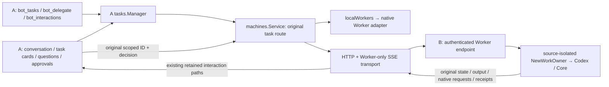

# Bot-to-Bot Workers

This implements the Worker connection in [#217](https://github.com/caelis-labs/caelis-bot/issues/217).
The implementation remains a Draft; the [review and completion gates](bot-to-bot-review-roadmap.md)
track independently reproduced defects and the remaining product/acceptance gaps.
It adds a `bot` machine profile, not another task manager. Local remains the
default. Choose an environment only when creating work; continuation, stop,
history, files and decisions retain the original machine and native owner.
Disconnection never selects local execution.

## Ownership and call flow

A's product record owns task identity, route, presentation, completion reporting
and host operation correlation. B records only authenticated source/task/runtime
bindings and native adapter receipts. The native runtime owns execution and
request outcomes. There is no remote task/run/approval state machine or execution
ledger. B's foreign owners live outside `localWorkers.WorkStates`, so B's product
Manager cannot import them. They have no Bot catalog, resident callbacks or
delegation tools. This is application isolation, not a separate OS sandbox.

B selects its configured Worker runtime and model/Team defaults at new-task
preparation. The selected runtime is persisted on both route and native binding;
the start freezes native execution settings. A supplies assignment, optional
target workspace and explicitly selected input bytes, never B's model credentials
or an execution-settings override. Existing bindings keep their original native
session regardless of either Bot changing defaults. A cannot use the peer
protocol to install runtimes, edit models/Team, or manage legacy helpers.

## Shared ports and modules

| Boundary | Implementation |
| --- | --- |
| Execution | `api.WorkRuntime`; native `codex.WorkOwner` / `caelis.WorkOwner` and their Sessions |
| Observe, guarded stop, full native decisions, original operation query, files | `api/work_service.go`; both native `work_service.go` files; `app/worker_service.go` |
| Product identity, reports, attachment selection and file references | `tasks.Manager`, `tasks/worker_service.go`, `tasks/input_files.go` |
| Environment/profile and original route | `machines.Service`, `machines/peer.go`; existing `TaskStart.Machine` |
| Explicit host projection and authenticated thin transport | `workerpeer/{wire,client,server}.go` |
| B native owner assembly and App lifecycle | `app/worker_peer.go`; headless mounts the same endpoint in its existing HTTP server |
| A full user interactions | existing retained approvals, Worker questions, Backend decision/URL/answer paths; `machines` implements the retained hook |
| Original loopback HTTP forms | shared `WorkURLChallenge`, original Codex adapter receipts, user-only desktop/Web UI; [scope](worker-peer-url-forms.md) |
| A output/history/files | shared `WorkerOutput`, desktop `WorkerTaskDialog`, web tasks; Backend/Manager route every reference to its original task |
| Setup | `BotConnections` in existing machine settings; Backend Worker-sharing/connection methods |

The companion ports fill real adapter gaps: complete native request projection,
live child output, task files/input encoding, guarded stop and correlated native
receipts. The old manager was not reused without changes. Product operations
remain in it; adapters remain responsible for native semantics.

The renderer's `json:"-"` fields remain hidden. Host wire DTOs explicitly preserve
`AsyncQuestions`, `AsyncCallID`, `Approval.TaskID` and `NativeID`. A scopes routing
references by task while preserving the original raw native IDs separately. B
chooses the source namespace exclusively from the bearer grant, not caller JSON.
Same native IDs in different tasks or authenticated sources cannot select one
another's requests, history or files.

## Pairing, authorization and lifecycle

A adds B by reachable address/optional port and submits a short, durable connection
request. B's local user allows or declines it from Connection requests, with source
name/address/fingerprint. A returns immediately and checks the original request
only manually or on reentering the page. Pending/unknown connections are never
Worker environments. Each direction needs an independent approval and proof.

The existing machines profile owns the durable source/proof/intent. A reads and
pins B's instance identity before any request write; B verifies that target. B's
existing `peers.json` owns pending decisions and active grants, committed atomically.
No task/execution ledger or authorization manager is added. Names, network addresses
and loopback access do not confer trust. Credentials never enter renderer/Agent
snapshots. Same-ID different content is refused, terminal IDs do not revive, and
uncertain delivery is queried against the original target/proof rather than replayed
as another intent. The inbox/identity retention is bounded; capacity affects only
remote pairing, never local chat or Worker health.

There are no verification codes, sharing switch, account center, legacy helper
execution environment, remote installation or experiment migration.
`/worker/v1/identity` is a public, non-native identity declaration; `/pair` submits or
reads a proof-bound request. `/call` and `/events` always require a granted source,
including loopback/SSH. Browser Origins are rejected and redirects never receive
credentials. Plain HTTP relies on protected external transport, not pairing for
encryption. Tailscale remains outside Bot. Optional standard [SSH channels](ssh-connections.md)
provide connectivity only, with no helper execution or additional task authority.

The desktop App owns a peer-only listener, default 9317 with OS port fallback on
conflict. It persists the actual endpoint. A reachable headless listener is reused;
a loopback-only browser surface is never widened. Connection details publish the
actual peer address/port. Listener or registry failures degrade only the peer feature.

Readiness inspects B's configured local Worker without an empty readiness owner.
An omitted Caelis effort inherits that selected model's native default. Existing
source/runtime bindings still resolve their original native owner. New work may
prepare a replacement only after the adapter verifies the original private process
has exited; existing task/decision receipts are never migrated or replayed.

## Recovery and interaction semantics

- The HTTP caller never retries a write automatically. A retains original
  operation ID plus intent digest; adapters extend their existing receipts. Query
  reads that exact operation. Unknown remains unknown, without new ID, owner or
  substitute execution. File digests bind names/bytes, independent of staging paths.
- Stop carries original operation ID and complete native execution target. The
  adapter checks under its native operation/cancel lock immediately before the
  native stop; it is not an HTTP preflight followed by legacy unguarded stop.
  Late old stops cannot interrupt a later turn, or a changed same-turn run handle.
- Async questions retain their original call IDs across turns. Full ordinary,
  sensitive, opaque and supported URL requests reach A's existing user chain.
  Agent views retain their existing limited choices and cannot fill sensitive
  fields or manufacture success. Decisions return to the original native owner;
  the native receipt determines the outcome.
- SSE publishes bounded current Worker snapshots, not B chat or a durable event
  log. A keeps at most 16 live subscriptions; regular state polling covers the
  rest. Completed history stays on demand. Reconnect reads current state and
  pending requests, then native history as needed. It never replays a write.
- Subscriptions bind the full connection and original runtime. Address/token
  changes cancel and replace them; both stale successes and stale errors are
  discarded. A transient Connect error removes fresh activity evidence and
  reserves unknown capacity. Only the native adapter can confirm owner loss.
- Control receipts keep their original IDs/digests and unknown outcomes. Approval
  history does not consume the existing Codex prompt quota or prevent guarded
  stop; an exact pre-dispatch rejection is not reported as an unknown write.
- Desktop and Web ask the same host reader to validate the original pending
  request before opening its URL. A snapshot URL alone is not authority. This
  entry-point fix alone does not complete a B-local challenge. The bounded
  original-request HTTP-form path now has a real Codex A/B/React completion;
  native consent and webpage effect remain independently verified facts. Original
  URL receipts are read from the frozen binding even when native execution or B
  resident model setup is offline. No reconnect, replacement or model selection
  is needed for that read; new work still uses B's actual configuration/readiness.
- Completed execution, readable native history and question closure are separate
  facts. A history-read failure preserves cached content and a read failure state.
  A vanished native response channel becomes unknown audit evidence, never an
  actionable approval or an implicit approval.
- Files are selected artifact references plus bounded byte transfer, not paths
  on A or generic synchronization. Input references must belong to A's retained user-selected uploads, resident
  artifacts or an owned Worker. Output reads must belong to the original native
  task; A downloads a private checked copy before opening/previewing it. Native
  adapter limits apply equally locally/remotely: Codex up to 8 inputs of 20 MiB;
  Caelis up to 4 inputs of 8 MiB. The host output byte limit is 20 MiB per file.

## Capability and verification limits

`contract`, actual native `owner`/`build`/`runtime`, `history`, `observe`,
`interactions`, `files`, `reconcile`, `url`, and `pendingAcrossRestart` are fixed
fields. Stable peer identity is separate. New task admission checks the actual
prepared owner; old-task operations check that task's retained native evidence.
An App upgrade cannot upgrade old native bindings. Missing mandatory capability
fails closed. Legacy bindings without native owner/build evidence are not promoted.

| Behavior | Codex | Caelis |
| --- | --- | --- |
| Create/continue/output/history/files/original receipts/guarded stop | Shared ports, fixture and integration coverage | Shared ports, native HTTP fixtures and integration coverage |
| Ordinary/secret forms and native option/opaque request projection | Native forms/options/opaque preserved | Native option/opaque projection; form answers rejected because the consumed native protocol has no form contract |
| URL | Reachable original HTTP(S) URLs use the owner-checked browser; B-loopback static forms use the shared user-only portal plus original native consent | No generic native URL request contract claimed |
| B-only loopback pages beyond the static form subset | Explicit first-release deferral: B-only multistep/GET/JS/redirect/different-action pages, B-loopback login callbacks, B-only certificates/browser state; see [support boundary](worker-peer-url-contract.md) | Match existing local support; no new generic form/URL feature |
| Transport reconnect while original native owner/request survives | Fresh state/requests read, no replay | Fresh state/requests read, no replay |
| Native owner restart restores old pending response channel | `pendingAcrossRestart=false`; vanished channel is unknown; fresh native reissue required | `pendingAcrossRestart=false`; native option state is read, but general restart parity is not claimed |

Evidence is separated by layer. `4f186371` covers production A/B HTTP/React/Bot
MCP with a controlled native process; its CSV/PDF/PNG, output/download, offline copy,
unknown-create and upload-period UI Stop assertions remain at that layer.
`de4b791c` additionally passed a clean same-SHA **real Codex 0.162.1 + isolated
Mock MCP/local controlled model + actual A/B/React** six-case URL journey: original
IDs, webpage effect, original native confirmation and continuation once; decline,
expiry, native-owner exit and both response-loss boundaries. This is not a real
account, third-party OAuth, physical dual-machine or native-GUI journey.
CI39983328004 at that SHA passed scope, macOS, Linux, Windows and product. Earlier
Windows persistence timeouts remain recorded with unknown cause; a green run does
not establish flakiness or erase those failures. The URL independent review found
two additional issues, now covered by negative/positive regressions: offline
receipt routing/host assembly, and unsupported readonly/disabled/inert semantics.
The latter are refused rather than silently changing the website's controls.

Core v0.73.2 shares the pinned public source/schema/wire and passed released native
Host/old-session upgrade checks with isolated controlled model endpoints. Real
account/model, physical-machine and native-GUI/upgrade acceptance remain separately labeled, nonblocking follow-up under the latest review scope.
Physical dual-host and native GUI controlled-model evidence at `8f203370` is
recorded separately in the [roadmap](bot-to-bot-review-roadmap.md); it does not
prove later-head or real-account acceptance. The user explicitly deferred named
B-only browser flows for the first release. Public reachable HTTP(S), including
scripts/OAuth whose required callbacks are reachable, remains on the normal
browser path. The bounded static portal remains supported. This is an honest
local-to-remote limitation for the deferred classes, not a repair or native success.
No external-forward opener, automatic tunnels, general proxy or credential/state
migration is added. Caelis local generic form/URL expansion is outside this PR.
Confirmed invalidation and unknown prior effects remain separate; dead native
continuations are not revived. Q22 isolated account/model input is still missing;
dependent real-account acceptance stays blocked without a repeated question.

Settings has a compact Bot-only list and Add machine. Connection requests are
asynchronous; the target user approves the machine connection, not delegated task
interactions. Approved/native-ready freshness is distinct from reachability.
Removing a current connection with tasks hides it from new delegation while keeping
those tasks' exact routes; it never stops execution. This is not support or migration
for the retired code/helper experiment.

No discovery, scheduler, cluster, tunnel management, Notebook/database sync,
A-owned B configuration or general file sync is implemented.

## Selected uploads and retrieved output

Before resident submission, A snapshots explicitly selected files into a private
byte cache and supplies opaque `upload-file:` references to its Agent. The stored
manifest binds the original submission, ordered filenames and byte digests; it
contains no chat body, native effect or task state. `bot_delegate` uses the existing
attachments argument for new/continued local and peer Workers. A resolves an owned
reference to bytes, while B stages only authenticated task-scoped bytes. A read-only
`WorkInputValidator` uses each actual native adapter's limits before a new product
record/dispatch; native dispatch retains its own validation and original receipts.
An existing uncertain operation is reconciled, never re-prepared as new work.

`bot_tasks file` retrieves a checked private A-local copy and returns its path,
SHA-256, byte count, media type and fetched/cache status. The Agent uses normal native
file/image tools on that copy. The cache contains only immutable bytes and task/ref
indexes; it cannot execute, approve or settle a task. Ownership is rechecked before
any cache read. Names remain original metadata; portable cache paths are local to A.
User open/save uses the same copy; Web previews authenticated PDF/raster content and
downloads other types. Retrieve again checks the original owner. Failure can retain
the last verified bytes with the original timestamp and `cached=true`; this is not
proof of the remote latest version. Already retrieved output works with B offline.

Live items carry a native history join key. B keeps a bounded current Worker view;
A's bounded mounted reader retains observed completed output until the matching
native message is read successfully. Equal text is never a deduplication key. History
failure preserves prior content and its read-failure state. Legacy projections with
no native message-level identity keep their evidence instead of inventing a join.

The byte/reader/HTTP/native-adapter tests cover this path. Real model interpretation,
packaged preview/save and cross-machine GUI acceptance remain separately labeled,
nonblocking follow-up under the latest review scope.

## File preflight and admission deadlines

Peer preflight sends file names and byte counts, never attachment bytes. B checks
its actual owner's declared count/size limits; missing limit evidence is an
incompatibility for file delegation. Native dispatch still checks the exact
bytes and original digests. Preflight does not create a native task or receipt.

Plain delegation keeps its 25-second admission limit. File delegation budgets
the existing maximum 8 x 20 MiB input plus JSON base64 overhead at a 1 MiB/second
transfer allowance, then the same 25-second control budget: 239 seconds. The
private bridge and native task MCP envelope add 10 seconds each (249/259 seconds).
This is a bounded policy allowance, not a measured speed or a guarantee for every
network. A shorter caller deadline and cancellation still win. Only authenticated
peer request bodies receive this allowance; browser trust and deadlines stay as
configured. A timeout after dispatch remains unknown and reconciles its original
operation; it never authorizes replacement work or an automatic upload replay.

## Pairing readiness and new work

Submitting and listing requests opens no native owner. Local B approval checks
only configured Worker readiness, outside the grant lock. Missing settings/auth,
unavailable native services and model-catalog errors retain different safe reasons.
An existing Worker binding does not depend on B's current resident/default settings.
See [current connection flow](remote-machines-ui.md) for endpoint and error behavior.

## Worker file cache lifecycle

The existing attachment usage and cleanup actions include `WorkerInputs`, task
input staging, and checked task output copies. Cleanup uses the existing host
Trash operation and 30-day retention; it never scans or removes user-selected
source files or a Worker's workspace. It adds no execution ledger.

Maintenance fences resident admission and task preparation, then reads reference
identities from the full conversation store and retained product task records
(including unpinned/quarantined tasks). Original active or unknown operations
retain their input references and paths. Unloaded/damaged reference stores,
legacy task records without file provenance, and unconfirmed persistence retain
bytes conservatively. Preparation rejection/cancellation removes only new,
unpublished staging copies; an uncertain native receipt is not a rejection.
Immutable upload intent manifests remain after unreferenced old bytes retire, so
cleanup cannot permit different content under an original submission ID.

Current indexed output copies stay available offline, and can be attached to
another owned task without contacting B. Only old superseded/unindexed output
objects not referenced by task inputs are cleanup candidates. Cached results
remain last-retrieved bytes, not evidence of the remote latest version. Cache
read/publication and cleanup share per-root locks; damaged indexes, symlinks,
changed file identities, and failed Trash operations do not authorize deletion.

Storage tests use isolated directories and synthetic Trash callbacks through the
real application usage/cleanup entry points. The 4f186371 application journey
subsequently verifies upload-period UI Stop and B-offline copies. Remote URL
completion, same-SHA real-machine/account/GUI and final independent review remain
open; see the [current roadmap](bot-to-bot-review-roadmap.md).

## Final independent audit

See [current closure and regression map](worker-peer-final-audit.md). The current
request flow pins the recipient before delivery, atomically commits the target's
local decision/grant, retains original request evidence and keeps pending peers
out of execution/admission. Body/queue/network budgets remain local to the peer
feature. Archived current-protocol connections restore by reading their original
intent, without replacing proof/owner or demanding another approval for an already
approved source. Experimental code/SSH/helper state has no migration path.

Native task/interaction/file/receipt authority is still in the shared adapters.
Equal native IDs across sources cannot cross task, file, history or approval scope.
Local operations remain independent of remote failures and a broken peer registry.
The bounded URL scope and separate evidence levels remain unchanged.

## Local availability boundary

A remote environment is optional execution capacity. Its uncertain work reserves
only that environment's slots; total task counts remain presentation totals.
Remote native I/O, cleanup and history do not hold Manager's local admission
fence or machines' routing mutex. Each peer retains its own serial admission and
original binding; cancellation releases live waiters, and no failure falls back
local. Existing task reads/observations/decisions use the frozen B source/runtime
owner even if B's current resident/default configuration is unavailable.

Web pending writes use original request/profile scope. First pairing persists
its original proof/intent before Web admission; a host restart queries that same
reference. Historical remote unknowns neither become successful nor lock local
updates. A definitely undispatched ingress failure CAS-rolls back only its own
preparation; actual uncertain pairing retains proof. Fixed authenticated reads
leave HTTP write drain before network I/O. Current mutations keep finite original
owner deadlines and native/local unresolved writes retain their stricter guards.
Final automated/review gates are listed in the roadmap. Missing Q22 account input
is not permission to read or use daily accounts, and is no longer a merge gate.
