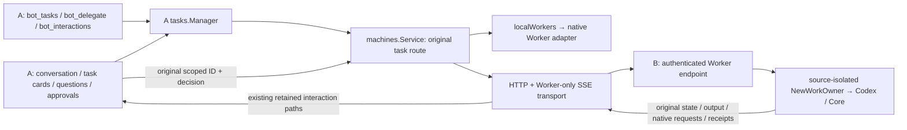

# Bot-to-Bot Workers

This implements the Worker connection in [#217](https://github.com/caelis-labs/caelis-bot/issues/217).
The implementation remains a Draft; the [review and completion gates](bot-to-bot-review-roadmap.md)
track independently reproduced defects and the remaining product/acceptance gaps.
It adds a `bot` machine profile, not another task manager. Local remains the
default. Choose an environment only when creating work; continuation, stop,
history, files and decisions retain the original machine and native owner.
Disconnection never selects local execution.

## Ownership and call flow

A's product record owns task identity, route, presentation, completion reporting
and host operation correlation. B records only authenticated source/task/runtime
bindings and native adapter receipts. The native runtime owns execution and
request outcomes. There is no remote task/run/approval state machine or execution
ledger. B's foreign owners live outside `localWorkers.WorkStates`, so B's product
Manager cannot import them. They have no Bot catalog, resident callbacks or
delegation tools. This is application isolation, not a separate OS sandbox.

B selects its configured Worker runtime and model/Team defaults at new-task
preparation. The selected runtime is persisted on both route and native binding;
the start freezes native execution settings. A supplies assignment, optional
target workspace and explicitly selected input bytes, never B's model credentials
or an execution-settings override. Existing bindings keep their original native
session regardless of either Bot changing defaults. A cannot use the peer
protocol to install runtimes, edit models/Team, or manage legacy helpers.

## Shared ports and modules

| Boundary | Implementation |
| --- | --- |
| Execution | `api.WorkRuntime`; native `codex.WorkOwner` / `caelis.WorkOwner` and their Sessions |
| Observe, guarded stop, full native decisions, original operation query, files | `api/work_service.go`; both native `work_service.go` files; `app/worker_service.go` |
| Product identity, reports, attachment selection and file references | `tasks.Manager`, `tasks/worker_service.go`, `tasks/input_files.go` |
| Environment/profile and original route | `machines.Service`, `machines/peer.go`; existing `TaskStart.Machine` |
| Explicit host projection and authenticated thin transport | `workerpeer/{wire,client,server}.go` |
| B native owner assembly and App lifecycle | `app/worker_peer.go`; headless mounts the same endpoint in its existing HTTP server |
| A full user interactions | existing retained approvals, Worker questions, Backend decision/URL/answer paths; `machines` implements the retained hook |
| A output/history/files | shared `WorkerOutput`, desktop `WorkerTaskDialog`, web tasks; Backend/Manager route every reference to its original task |
| Setup | `BotConnections` in existing machine settings; Backend Worker-sharing/connection methods |

The companion ports fill real adapter gaps: complete native request projection,
live child output, task files/input encoding, guarded stop and correlated native
receipts. The old manager was not reused without changes. Product operations
remain in it; adapters remain responsible for native semantics.

The renderer's `json:"-"` fields remain hidden. Host wire DTOs explicitly preserve
`AsyncQuestions`, `AsyncCallID`, `Approval.TaskID` and `NativeID`. A scopes routing
references by task while preserving the original raw native IDs separately. B
chooses the source namespace exclusively from the bearer grant, not caller JSON.
Same native IDs in different tasks or authenticated sources cannot select one
another's requests, history or files.

## Pairing, authorization and lifecycle

1. On B, enable “Allow other Bots to use this work environment” and generate
   pairing information. Generation checks local native readiness/admission. A code
   lives for five minutes and is consumed once.
2. On A, add a Bot with reachable address, code and optional display name. Pasting
   copied connection information fills address/code. The network is external:
   SSH forwarding and Tailscale are not managed or discovered by Bot.
3. A checks actual native capabilities/readiness, persists its private credential
   before sending the pairing write, and pins B's stable instance identity. A lost
   response is reconciled with that original credential. Renaming is local and works offline. An address change checks the same pinned
   peer with its original proof, without another code. Revoked access requires a
   fresh B code plus the original proof; a new profile cannot take over retained work.
4. B can revoke a source or disable sharing. Authorization is mandatory even on
   loopback. Revocation terminates subsequent calls/SSE without approving pending
   requests or cancelling native execution. A fresh code plus original credential
   is required to explicitly restore a source with retained work.

B labels each grant with A's supplied machine name, a short source identity and
pairing time, sorted by stable source ID. Display metadata never grants access.
Failed preparation has not crossed the native start boundary and can be released;
dispatched or uncertain work keeps its binding. A never discards its sole pairing
proof when B has not confirmed removal.

Peer endpoints are `/worker/v1/pair`, `/worker/v1/call` and
`/worker/v1/events`. They do not accept browser cookie/loopback exemptions; a
browser Origin is rejected, and redirects never forward the peer credential.
Credentials stay in private host state, absent from renderer/Agent snapshots.
Plain HTTP assumes the user's protected external transport; pairing alone does
not provide transport encryption.

The desktop App owns one loopback listener. It initially obtains an OS-assigned
port, persists the successful address in `WorkerPeers/listener.json`, and reuses
it on restart; a conflicting retained port fails visibly at sharing setup rather
than silently moving an existing endpoint. Headless mounts the peer handler on
its existing listener before browser middleware. Existing browser origin/CSRF,
9317 policy, launcher, tunnel and fallback behavior are unchanged. B settings show the actual listener separately from the address A should use.
The desktop listener can explicitly bind a reachable IP/interface; wildcard binds
require a concrete published address. Headless keeps its existing HTTP listener: use
its external `--listen` startup option to change that bind, then publish the address
in settings. Bot does not create SSH forwards, Tailscale configuration or TLS. A
checks the supplied entry against the paired identity and current Worker admission.
Changing a desktop listener binds and saves the new endpoint before closing the old;
a conflict preserves the old listener. Published addresses and successful ports persist.

Native owners detach through the existing owner lifecycle when the App closes.
Codex retains its original native socket and ordinary reconnect refuses replacement
if it disappears. “Prepare new work” is an explicit action on A's connection and
B's sharing setup (including an empty readiness owner). The native adapter checks
the original private PID and birth identity; only a confirmed exited process permits
archiving original bindings/receipts and preparing a new native owner. An alive or
unverified process is not replaced. This never moves or resubmits old tasks. Shared
daemon reconnect remains separate, with no new shared-profile process.
Inbound execution bindings, including readiness-created owners, are not imported
into B's resident runtime. This does not introduce another shared-profile daemon.

## Recovery and interaction semantics

- The HTTP caller never retries a write automatically. A retains original
  operation ID plus intent digest; adapters extend their existing receipts. Query
  reads that exact operation. Unknown remains unknown, without new ID, owner or
  substitute execution. File digests bind names/bytes, independent of staging paths.
- Stop carries original operation ID and complete native execution target. The
  adapter checks under its native operation/cancel lock immediately before the
  native stop; it is not an HTTP preflight followed by legacy unguarded stop.
  Late old stops cannot interrupt a later turn, or a changed same-turn run handle.
- Async questions retain their original call IDs across turns. Full ordinary,
  sensitive, opaque and supported URL requests reach A's existing user chain.
  Agent views retain their existing limited choices and cannot fill sensitive
  fields or manufacture success. Decisions return to the original native owner;
  the native receipt determines the outcome.
- SSE publishes bounded current Worker snapshots, not B chat or a durable event
  log. A keeps at most 16 live subscriptions; regular state polling covers the
  rest. Completed history stays on demand. Reconnect reads current state and
  pending requests, then native history as needed. It never replays a write.
- Subscriptions bind the full connection and original runtime. Address/token
  changes cancel and replace them; both stale successes and stale errors are
  discarded. A transient Connect error removes fresh activity evidence and
  reserves unknown capacity. Only the native adapter can confirm owner loss.
- Control receipts keep their original IDs/digests and unknown outcomes. Approval
  history does not consume the existing Codex prompt quota or prevent guarded
  stop; an exact pre-dispatch rejection is not reported as an unknown write.
- Desktop and Web ask the same host reader to validate the original pending
  request before opening its URL. A snapshot URL alone is not authority. This
  entry-point fix does not make a B-local loopback challenge reachable from A.
- Completed execution, readable native history and question closure are separate
  facts. A history-read failure preserves cached content and a read failure state.
  A vanished native response channel becomes unknown audit evidence, never an
  actionable approval or an implicit approval.
- Files are selected artifact references plus bounded byte transfer, not paths
  on A or generic synchronization. Input references must belong to A's retained user-selected uploads, resident
  artifacts or an owned Worker. Output reads must belong to the original native
  task; A downloads a private checked copy before opening/previewing it. Native
  adapter limits apply equally locally/remotely: Codex up to 8 inputs of 20 MiB;
  Caelis up to 4 inputs of 8 MiB. The host output byte limit is 20 MiB per file.

## Capability and verification limits

`contract`, actual native `owner`/`build`/`runtime`, `history`, `observe`,
`interactions`, `files`, `reconcile`, `url`, and `pendingAcrossRestart` are fixed
fields. Stable peer identity is separate. New task admission checks the actual
prepared owner; old-task operations check that task's retained native evidence.
An App upgrade cannot upgrade old native bindings. Missing mandatory capability
fails closed. Legacy bindings without native owner/build evidence are not promoted.

| Behavior | Codex | Caelis |
| --- | --- | --- |
| Create/continue/output/history/files/original receipts/guarded stop | Shared ports, fixture and integration coverage | Shared ports, native HTTP fixtures and integration coverage |
| Ordinary/secret forms and native option/opaque request projection | Native forms/options/opaque preserved | Native option/opaque projection; form answers rejected because the consumed native protocol has no form contract |
| URL | Native URL challenge fixture completes original request; A can open a reachable native URL | `url=false`; no native URL request contract claimed |
| B-local loopback/unspecified native URL from A | Explicit `remote_native_url_not_reachable`; no rewrite or proxy | Unsupported |
| Transport reconnect while original native owner/request survives | Fresh state/requests read, no replay | Fresh state/requests read, no replay |
| Native owner restart restores old pending response channel | `pendingAcrossRestart=false`; vanished channel is unknown; fresh native reissue required | `pendingAcrossRestart=false`; native option state is read, but general restart parity is not claimed |

Evidence is deliberately separated: native protocol fixtures, actual HTTP/SSE
dual-instance fixtures with real Manager/machine routes, race tests, repository
checks, account-free local Codex initialize, and browser component preview. No
real account/model, cross-machine execution, signed packaged desktop, Windows GUI
or live Core URL/pending-restart acceptance is implied by those tests. General
URL and cross-native-restart interaction parity remain blocked by the limits
above; users are never asked to resolve foreign work on B.

New-task environments list only local and Bot peer profiles; the old SSH add
entry is retired. Existing SSH helper profiles and original history paths remain
intact, with their saved setup repair and native continuation routes. The
previous same-protocol/different-`messages` capability failure motivates explicit
owner capabilities; no migration, takeover or helper-management expansion is
included. No discovery, scheduler, cluster, forwarding, Notebook/database sync,
remote install, A-owned B configuration or general file sync is implemented.

## Connection maintenance

Connection checks distinguish unreachable endpoints, expired/invalid codes, disabled
sharing, revoked access, missing original proof, incompatible contracts and a Worker
that needs setup on B. UI guidance names the target; raw native errors and credentials
are not shown. Explicit checks and a bounded 30-second Bot-profile health check update
freshness, including profiles with no tasks. New delegation requires fresh readiness;
old task identity/capacity never follows that health cache.

Removing a Bot connection with retained tasks archives it for new delegation, while
keeping the sole original proof and task routes. It remains visible as retained-tasks
only with Check / restore. Reauthorization on that original connection restores the
same task owners; no internal JSON editing or new execution is needed. Removal,
revocation and sharing-off never mean stop or approve. Connections without dispatched
work are removed only after B confirms unpair; an uncertain response retains proof.

## Selected uploads and retrieved output

Before resident submission, A snapshots explicitly selected files into a private
byte cache and supplies opaque `upload-file:` references to its Agent. The stored
manifest binds the original submission, ordered filenames and byte digests; it
contains no chat body, native effect or task state. `bot_delegate` uses the existing
attachments argument for new/continued local and peer Workers. A resolves an owned
reference to bytes, while B stages only authenticated task-scoped bytes. A read-only
`WorkInputValidator` uses each actual native adapter's limits before a new product
record/dispatch; native dispatch retains its own validation and original receipts.
An existing uncertain operation is reconciled, never re-prepared as new work.

`bot_tasks file` retrieves a checked private A-local copy and returns its path,
SHA-256, byte count, media type and fetched/cache status. The Agent uses normal native
file/image tools on that copy. The cache contains only immutable bytes and task/ref
indexes; it cannot execute, approve or settle a task. Ownership is rechecked before
any cache read. Names remain original metadata; portable cache paths are local to A.
User open/save uses the same copy; Web previews authenticated PDF/raster content and
downloads other types. Retrieve again checks the original owner. Failure can retain
the last verified bytes with the original timestamp and `cached=true`; this is not
proof of the remote latest version. Already retrieved output works with B offline.

Live items carry a native history join key. B keeps a bounded current Worker view;
A's bounded mounted reader retains observed completed output until the matching
native message is read successfully. Equal text is never a deduplication key. History
failure preserves prior content and its read-failure state. Legacy projections with
no native message-level identity keep their evidence instead of inventing a join.

The byte/reader/HTTP/native-adapter tests cover this path. Real model interpretation,
packaged preview/save and cross-machine GUI acceptance remain M4 gates.

## File preflight and admission deadlines

Peer preflight sends file names and byte counts, never attachment bytes. B checks
its actual owner's declared count/size limits; missing limit evidence is an
incompatibility for file delegation. Native dispatch still checks the exact
bytes and original digests. Preflight does not create a native task or receipt.

Plain delegation keeps its 25-second admission limit. File delegation budgets
the existing maximum 8 x 20 MiB input plus JSON base64 overhead at a 1 MiB/second
transfer allowance, then the same 25-second control budget: 239 seconds. The
private bridge and native task MCP envelope add 10 seconds each (249/259 seconds).
This is a bounded policy allowance, not a measured speed or a guarantee for every
network. A shorter caller deadline and cancellation still win. Only authenticated
peer request bodies receive this allowance; browser trust and deadlines stay as
configured. A timeout after dispatch remains unknown and reconciles its original
operation; it never authorizes replacement work or an automatic upload replay.

## Pairing readiness and new work

Generating a pairing code checks the configured local Worker and model within
the caller's budget. It does not select a runtime/model or create a separate
foreign readiness owner. Authenticated pairing and new-work preparation create
or reconnect only that source's isolated execution owner. The native adapter may
archive a confirmed exited private owner before preparing new work; ordinary
reads never authorize replacement, and old tasks, native request IDs and unknown
receipts stay bound to their original execution.

Connection rows show the environment name and availability. Listener/published
address and diagnostic freshness live in details. A saved unavailable connection
has one relevant restore action; editing its address or pairing code uses the
normal save/connect path. Restore never stops old work or approves a request.
