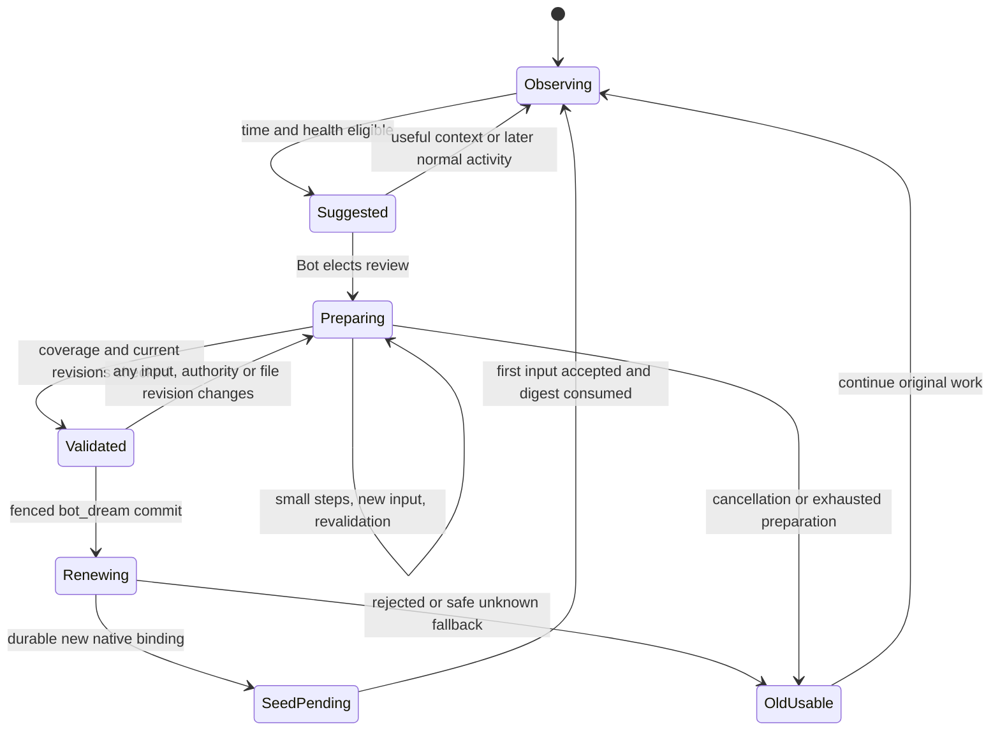

# Bot continuity: staged memory review and session renewal

Status: phase-two proposal, not implemented. Review phase one before starting this
work. Phase one changes the packaged Skill and its loading fixtures only; it does
not enable scheduled maintenance, change Dream admission or change Memory injection.

## Purpose and authority

Keep one personal assistant identity across meaningful internal Session generations.
Use real elapsed time and measured context health to offer a private, optional
review cue. The Bot consolidates continuing work and memory in small steps, then
uses the existing `bot_dream` terminal handoff when that improves continuity.
A healthy old Session stays in use. Age, a token count or an app upgrade alone
must not trigger a cue, maintenance turn or renewal.

The user has explicitly authorized designing time/health cues. This proposal
supersedes the earlier model-only direction for future implementation; the
[current product behavior](../product.md#连续性与主动工作) remains unchanged until
that implementation is reviewed and validated. No idle LLM polling, timer-driven
forced rotation, new conversation navigation or second task/approval authority.

## Evidence and current gaps

The source baseline is `d22c7696800d54d411ae231d7689e31839b6bf79` (including
approval snapshot ordering PR #253). Source inspection is evidence of code behavior,
not proof that the formal account exercised it.

| Observation | Evidence / limit |
| --- | --- |
| Formal Codex conversation dates from September 19; no observed `bot_dream` or `handoff-codex.json`; post-compaction records mostly 80–96k and latest about 119k | User-provided investigation, not re-read from the formal profile in this change. `input_tokens=0` is not a billing total or reliable trigger. |
| `MEMORY.md` is automatically supplied at a new Session's first input, not every turn | [`Vault.PrepareContext`](../../internal/notebook/context.go), [`contextseed.State`](../../internal/backend/contextseed/seed.go), both adapter `context.go` files. Acceptance is persisted before consumption; an unknown first send keeps its frozen original seed. |
| Auto-injection can currently omit Memory | [`app.go` PrepareContext callback](../../internal/app/app.go) reports a file-read failure internally and continues with an empty seed. Missing files are allowed; nonregular/invalid UTF-8/over-128-KiB files fail. “Every Session always has current memory” is therefore not yet a strict guarantee. |
| INDEX is generated navigation, not a body/status index | [`Vault.Refresh`](../../internal/notebook/vault.go) sorts Markdown paths descending, extracts titles, skips hidden/symlink entries and excludes legacy HANDOFF. Dated paths form a time navigation aid; arbitrary filenames are not a chronological event log. App startup, submit preparation and completion refresh it. It is not injected. |
| No current host age/health wake | [`dream.go`](../../internal/bot/dream.go) only recovers legacy receipts; `TestNoAutomaticDreamEvenAfterUpgradeAndHighUsage` covers that boundary. |
| Dream requires original invocation and a nonempty handoff of at most 16 KiB | [`dream_tool.go`](../../internal/bot/dream_tool.go), [`handoff.go`](../../internal/bot/handoff.go): durable private summary, terminal turn, original renewal receipt, accepted first-input digest consumption. Old binding is retained on rejected/unknown fallback; a successful tool response alone does not prove renewal. |
| Context evidence is incomplete across adapters/restarts | [`api/context.go`](../../internal/backend/api/context.go) has live `Used`, `Window`, `ModelAt`, `UsageEvidence`, not Session creation time or a pressure history. Codex [`usage.go`](../../internal/backend/codex/usage.go) rejects zero input counters; [`projection.go`](../../internal/backend/codex/projection.go) invalidates usage on native compaction. Caelis [`usage.go`](../../internal/backend/caelis/usage.go) requires a fresh same-turn gauge/provider pair. Neither should infer health from billing totals or restored transcript counters. |
| Existing owners already retain work and decisions | [`tasks.Manager`](../../internal/tasks/manager.go), [`interaction lifecycle`](interaction-lifecycle-followup.md), [`event arrangements`](../architecture.md#registered-event-arrangements) keep execution generations, original receipts, cancellation and expiry. A completed turn is not task completion. |
| Caelis retired-tool reclamation is distinct from renewal | User-provided Core fact: only marked-retired tools are collected at a safe checkpoint. This Bot change neither verifies the Core implementation nor assumes active recalled tools expire. Do not use schema count/age as an automatic eviction instruction. |

Phase-one verification and its exact commands/results belong in the PR. Native
Runtime fixtures use synthetic providers: they verify transport and context
boundaries, not the model's judgment or formal-account behavior. The acceptance
matrix below describes additional phase-two work, not results already obtained.

## Minimal implementation

Reuse `internal/bot`, `ConversationState`, `contextseed`, private handoff records,
Notebook, task/interaction ledgers and existing report/schedule admission. Extend
their boundaries rather than adding a memory database or another workflow engine.

1. Add a small provider/session-scoped continuity record under app-private storage:
   observation start, proven creation time if available, a bounded health sample
   ring, last cue receipt, cooldown and preparation progress. Do not reuse the
   retired `dream-*.json` scheduler or infer birth time from it.
2. Project typed health observations and compaction events in each adapter. Keep
   usage/billing fields separate. Persist only bounded evidence with original
   session/turn/model identity and timestamps; historical samples are not live
   evidence after reconnect or a model/window change.
3. Run a pure eligibility function on already observed turn-completion/input
   boundaries. Attach one private cue to the next ordinary admitted input/report
   through existing host provenance. Do not create an idle model turn. Persist cue
   admission with that original input, so a lost response cannot replay it.
4. Extend the existing `bot_dream` request with a small preparation operation
   (`prepare`, `validate`, `discard`) returning an opaque preparation token and
   bounded original-record pointers. The existing handoff call remains supported.
   Add a `preparationToken` for final commit. Pin old catalog schemas so historical
   calls retain their original identity; legacy calls run the same host preflight
   internally and fail safely if a continuity revision changes during admission.
5. The Bot uses ordinary file/task/interaction/schedule tools for staged review.
   `prepare` and `validate` observe only; neither writes memory, decides a request,
   starts a Worker nor rotates a Session. `validate` checks current input/authority
   revisions and refreshed file digests, then supplies a commit token. Final Dream
   compares it under the existing input/tool admission fence before saving handoff.
6. Extend current handoff/seed preparation with the validated continuity manifest
   and current core memory; fail a planned renewal before switching if those
   required files or native references cannot be read consistently.

Preparation metadata belongs in the existing private handoff store (versioned,
with restart handling), and the small sample/cue record belongs to the Bot's
existing provider state. No new writable model memory API. The operation shape
and compatibility golden snapshots are reviewed implementation details, not
phase-one advertised capabilities.

## Algorithm inputs and initial policy

Inputs must distinguish known zero, unknown, stale and invalid. Use a fakeable
clock for tests and UTC durations for cooldowns; local dates are only for Notebook
navigation. Wall-clock jumps do not invent elapsed activity.

| Input | Source and use |
| --- | --- |
| Session identity and proven age | Native binding/creation evidence; otherwise first observation is a conservative lower bound. Never derive age from the oldest visible IM message, file mtime or Bot install time. |
| Recent real activity | Accepted resident input IDs/times and completed native model responses. Worker ticks, tool/UI updates and reconnects do not refresh model health. |
| Context pressure | Fresh same-session/model `used / window`, with source, event/turn ID and timestamp. Require a valid positive window and known gauge semantics. Store at most 32 samples spanning 7 days. |
| Compaction outcome | Native event identity, time and first valid post-compaction sample. Missing outcome/gauge remains unknown. No synthetic “compacted” fact from a token drop. |
| Health recovery | Low recent pressure and low compaction frequency reset the candidate. A changed model/window begins a new comparable sample series. |
| Admission blockers | Resident active work, pending native approvals, unread input, unknown resident effects, existing handoff, update/runtime transition and unavailable original owners. Use existing owners, not prose. |
| Continuity revision | All accepted/queued human ingress (including Stop/revocation), task execution/report revisions, interaction lifecycle/claim revisions, schedule/grant revisions and memory/file digests. |

Proposed conservative constants for review, not measured optimal thresholds:

```text
fresh := observed original binding + a valid current health observation
         no more than 15 minutes old, from the current model/window series
safe_to_cue := no competing resident turn/admission blocker and no unread input
old_pressure := proven_age >= 7 days
                and >= 3 distinct fresh-at-capture response samples over >= 1 hour
                with pressure >= 0.70
                and >= 2 confirmed compactions in the last active 24 hours
                whose first valid post-compaction pressure remained >= 0.60
acute_pressure := proven_age >= 24 hours
                  and >= 2 distinct samples over >= 10 minutes with pressure >= 0.85
                  and a confirmed native context-exhaustion failure or compaction
                  after which pressure still remained >= 0.80
eligible := fresh and safe_to_cue and (old_pressure or acute_pressure)
            and no accepted cue for this session in the last 24 hours
```

Every condition requires evidence; unknown fails eligibility rather than becoming
zero or satisfying pressure. A healthy Session (no sustained pressure/repeated
ineffective compaction) never qualifies merely through age. A fresh response below
0.60 clears accumulated pressure; two lower-pressure responses after a cue reset
its candidate. Upgrade/restart alone never resets the cue budget. Rollback of the
wall clock holds eligibility until elapsed time can be established again.

For zero `input_tokens`, phase two must first establish whether the native public
protocol exposes an independent, trustworthy context gauge. If so, project that
gauge independently of billable counters and test zero/missing fields separately.
If not, leave automatic eligibility unavailable for that provider and retain
model/user-requested Dream. Do not estimate from `total_tokens`, scrape private
Runtime memory, or use the user-provided 119k observation as a hard threshold.

A cue tells the Bot the observation period and evidence, asks it to assess whether
recent detail can be consolidated, and explicitly permits deferral when context
is useful. It is private host data, not a new user grant or a chat notification.
The Bot may perform useful preparation over subsequent normal turns. The cue's
24-hour suppression does not expire an unfinished preparation or authorize a
background retry. A user-requested review remains available regardless of policy.

No autonomous wake is needed for the first implementation. If the user requests
review at a later time, the Bot can create an ordinary authorized schedule; it
still uses the same preflight and cannot force Dream. Independent Worker notices
and existing schedules continue normally.

## Staged preparation and core memory

The Bot follows the memory reference with the following additional stage-two
contract. Each stage is resumable; progress records evidence/watermarks, not an
LLM promise that a checklist is complete.

1. **Inventory:** prepare on the current resident Session. Read the newest dated
   INDEX entries since the last successful review, with a minimum seven-day lookback;
   follow older open-work links from MEMORY and the prior review note. Read note
   bodies, then page current task/interaction/arrangement records. A review budget
   can limit a turn's work, but unvisited pages remain explicit unfinished coverage.
2. **Reconcile:** distinguish completed results, still-open commitments, awaiting
   input, revoked/cancelled work and unknown effects. Check original execution
   generations and receipts. Keep missing evidence unknown. Do not finish a task
   merely to remove a question or make the handoff smaller.
3. **Write:** update dated notes and the latest MEMORY without overwriting user
   edits. Read back writes. Maintain links for longer context, original handles,
   decisions/revocations and cleanup obligations. INDEX remains generated; refresh
   navigation after notes change, never edit its text manually.
4. **Validate:** refresh native records and input/authority revisions, read current
   file digests and review any changes since preparation. Resolve changed facts
   or explicitly retain their uncertainty. Call `validate` only after coverage and
   memory review are complete. A native read failure cannot certify the manifest.
5. **Commit:** deliver any due result, then call `bot_dream` with the validated token
   and bounded handoff. Runtime ends the owning turn and uses its existing renewal
   journal. No same-batch effect or model step follows the terminal call.

`MEMORY.md` should usually be about 4–12 KiB of UTF-8 text; 32 KiB is a review
threshold, not a truncation instruction. These are initial editorial budgets,
not new file limits. Preserve identity/personality, stable preferences, material
agreements and their current scope/revocations, and pointers to important open
work. A short file is valid when few facts exist; never pad it or drop critical
facts to hit a length. Move detailed chronology to notes, replace stale assertions
and avoid duplicated current claims. The existing 128-KiB read ceiling is a safety
bound, not a target. Byte count cannot certify semantic completeness.

The user may edit or delete memory at any time. Digest conflicts require re-read
and reconciliation, not automatic restoration from a last-known copy. For renewal,
unreadable/oversized core memory or incomplete review keeps the old Session usable;
never silently seed a new Session without required continuity. First-ever startup
with genuinely absent memory remains valid. Fresh seed injection reads the current
file at dispatch, freezes it for that original input and consumes handoff only
after durable native acceptance. Later file changes are read normally, not patched
into an already dispatched input under the same ID.

## Preserve work, decisions and authority

| Information | Durable owner and handoff treatment |
| --- | --- |
| Tasks | Existing task ledger retains task/environment/runtime/owner and execution generation. Manifest contains original handles and revision; new Session reads current records. No replacement Worker or migration of native ownership. |
| User scope and standing authorization | MEMORY/dated notes preserve exact agreement, source input reference, bounds, expiry and later revocation. They are context. Native approval/grant stores remain enforcement authority. A broad preference cannot turn into permission for another action. |
| Revocations and Stop | Existing ingress and native stop/grant/schedule receipts win over older summaries. Advance the continuity revision at ingress, before a delayed model sees the text. Never copy a captured grant snapshot back over a later revocation. |
| Pending questions/approvals | Original interaction IDs, bindings, choices and deadlines stay with their current owners. Preserve pointers plus unresolved requirements. Session renewal neither answers nor expires them, and a closure notice is not consent. |
| Unknown effects | Keep original request/operation IDs and outcomes in their existing journals. Manifest references them; unknown stays non-replayable even if task text says finished. Never create new IDs to restore progress. |
| Schedules and callbacks | Existing definitions, grants, occurrences, report IDs and delivery receipts survive unchanged. New context re-reads them; no callback duplication or assumed phone delivery. |
| Artifacts and resources | Notes retain original artifact references, paths, ownership and cleanup obligations. Active/dirty/shared/uncertain resources stay retained. |

The manifest is a bounded snapshot of pointers, revisions and coverage, never a
second source of truth. If handles exceed its budget, retain a stable page anchor
into the original ledger and mark remaining coverage; do not silently omit work.
Native approval payloads and secrets do not enter the summary. On the first new
Session input, include a bounded notice to read the referenced current records;
later actions still revalidate the original target. Bot identity and connections
remain unchanged.

The approval bridge work is already merged as PR #253. Its snapshot/ordering
regressions and native decision path remain intact. Phase one changes no bridge
interface. Phase two needs a narrow read-only interaction revision/pending snapshot
from the existing owner, plus an admission fence against decision/revocation races;
it must not copy choice authority into the model handoff. Coordinate that port
with the approval owner before implementation. A session-scoped pending resident
interaction blocks commit; independent Worker interactions may remain only if
original-owner routing and the revision fence are verified end to end.

## New input, races and fallback



Human input always wins over preparation. Record ingress before model admission;
new messages, answers and revocations invalidate the commit token. Continue that
same user goal in the old Session, apply the correction, then revalidate if still
useful. Do not discard or automatically resend a queued input. New Worker reports
and schedule events stay in their original delivery ledgers and either join the
review revision or wait for the resulting binding; they are not renewed effects.

Between validation and commit, compare revisions under a short admission fence.
Do not hold UI/ingress locks during file reads, network calls or model work. If
input arrives during native creation, keep its original ingress identity queued,
invalidate the prepared snapshot and prefer the old binding until reconciliation.
A created empty Session is not permission to execute anything. Before final binding
commit, recheck input epoch, original native state, current grants and file digest;
a stale candidate cannot replace the old binding. After binding commit, queued
input goes once to the new Session with seed and current continuity notices.

Caelis currently copies grants before renewal creation and checks resident state
again later; phase two must also compare grant/revocation revisions at commit.
Codex must keep its current original-call `thread/start` attempt fence; an unknown
empty-thread creation cannot be retried under a new call ID. Extend both existing
journals to record abandoned candidates without adopting them after fallback.
No auto-delete or guessed receipt reconciliation is required for an orphan.

Preparation read/write failure leaves previous files and the old Session. A failed
Dream save never ends the native turn. A rejected renewal continues the old binding.
An unknown renewal preserves its original attempt and summary, falls back only
when the old binding is authoritatively usable, and never reissues creation. A
failure after binding commit resumes that same new binding and first-input receipt;
it must not run both old and new Sessions. Native owner uncertainty may block the
affected send, but UI, drafts and independent Worker operations remain available.
Use bounded existing recovery and calm recovery surfaces, not a maintenance loop.

## Acceptance matrix

These scenarios are required phase-two tests; none is claimed as passed by the
phase-one Skill change.

| Scenario | Observable acceptance |
| --- | --- |
| Old healthy Session, upgrade, long sleep or reconnect | No cue, no model call and no renewal from age/idle/version alone. |
| Old sustained pressure with ineffective compaction | One cue on the next admitted ordinary input; original event/input IDs retained; no idle LLM invocation. |
| Acute pressure vs one high sample | Only the documented multi-sample/time/native-event predicate qualifies; one high sample does not. |
| Zero/missing billing, unknown window, stale/restored/Worker usage | No fabricated health or cost; independent valid gauge usable only when protocol semantics are proven. |
| Useful context after cue | Bot defers; same Session continues; cooldown survives restart; no forced Dream. |
| Recent INDEX notes plus an older open commitment | Bot opens note bodies and live records, follows the old link and retains both unfinished obligations. An unvisited page blocks certification. |
| Memory tiny, stale, duplicate, oversized, deleted or concurrently edited | Preserve key facts and user edits; reorganize without padding/truncation/resurrection. Unreadable required seed blocks renewal, not old-session use. |
| Worker completes but a required answer is missing | Original question stays pending; no finish token used merely to clear it. Closed questions grant nothing. |
| Worker continuation races with a late completion | Preserve current execution generation and new questions; old finish/report cannot close them. |
| Approval/revocation/Stop arrives during preparation, validation or creation | Token invalidates and current native authority wins; no snapshot can revive revoked scope or dispatch a stale option. |
| New human message at each handoff boundary | Exactly one original input reaches the authoritative binding with the latest constraints; no input lost, duplicated or hidden by review. |
| Worker report/schedule fires during handoff | Original report/occurrence receipt delivered once; no duplicate callback or external effect. |
| Unknown delegation/answer/send before and after restart | Same unresolved original IDs remain; new Session observes and never replays. |
| Disk failure / rejected or unknown native creation / crash at each persistence boundary | Old usable binding or the committed new binding remains singular; summary and receipts survive; no second create for an unknown attempt. |
| Successful renewal on Codex and Caelis | New native Session, stable Bot identity/Worker owners, current MEMORY and validated handoff at first input, no old transcript or recalled schema import, acceptance-only consumption. |
| Skill scope | Only metadata initially, body/references through native reads, no resident Skill/Notebook leakage into ordinary sessions or independent Workers. |

Start with pure-clock eligibility and revision-race fixtures, then both adapters
with installed native Runtimes and synthetic providers. Finally use an isolated
Bot profile and a real model for staged memory quality, deferral, new-message
priority and identity retention. Formal-account observation and native GUI behavior
remain separate acceptance categories. No production rotation is authorized or
performed by this design delivery.
