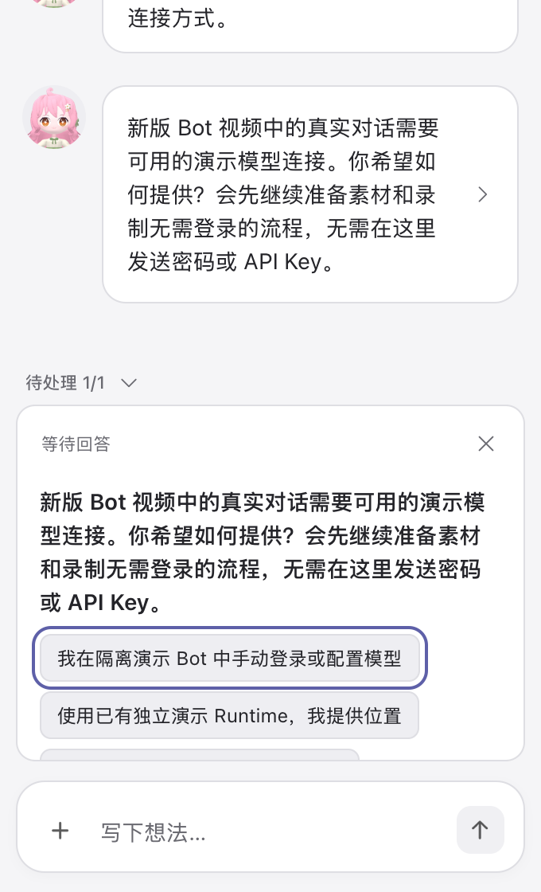
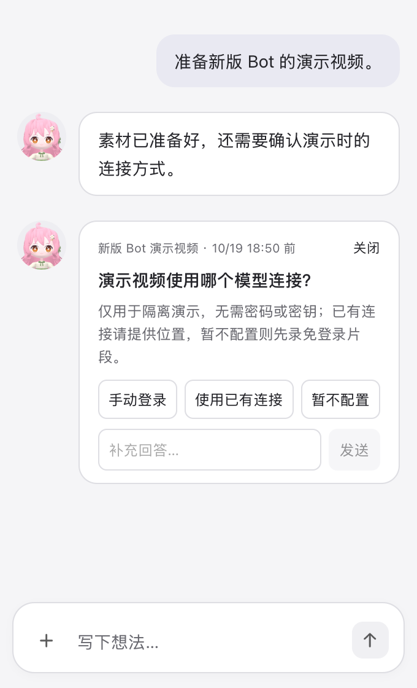

> This initial acceptance was rejected in independent PR195 review. See
> [review fixes and fresh evidence](review-fix/README.md) for the corrected
> semantics, actual smoke runtime, original long-copy and multiple-question cases.

# Async question lifecycle and native UI acceptance

2026-10-18. Base: `bb00cd465a8a756eb5b4274b6bcb6a7a5abbaf42` (PR #193).
The lifecycle decisions are recorded [here](../../design/async-question-lifecycle.md).

## Diagnosis

- Completed native async question items outlive native turns. The former seven-day
  reference check ran only while connected and did not reconcile cached IM cards.
  Answered, expired or recycled references could therefore still appear pending
  in the chat history, especially after reload or when older history was loaded.
- A Worker question and the resident's paraphrased async question had separate
  identities. Answering one could leave the other pending. `present` now exposes
  the original question with one state and original answer binding. Old unbound
  duplicates are not inferred answered from natural-language similarity.
- The previous UI duplicated the long question in history and a collapsible tray.
  At narrow sizes its bottom option was clipped beside the composer.

## Screenshots

All images are actual native WKWebView renders of the production History
component, with disposable synthetic data. The before image uses the unchanged
base renderer in a separate archive checkout; only the preview harness and data
were added. No private screenshot or real conversation was committed.

The narrow native window is 340 × 560 points of content (680 × 1120 pixels at
2×, plus the native title bar). This matches the supplied narrow screenshot's
340 × 592 point window including its title bar. Wide content is 760 × 672.

| Before | After, narrow |
| --- | --- |
|  |  |

[Dark narrow](after-narrow-dark.png) · [Wide](after-wide.png) ·
[Answered](answered.png) · [Dismissed](dismissed.png)

The new question body is 193 points high at the narrow size. All three options
and the always-visible custom input are fully visible. Its bottom is y=383;
the composer starts at y=490. No accordion, pending-question tray, internal scroll
area or question overlay remains. Avatars stay beside their messages. The question uses normal History flow instead of adding an overlay to its
placement geometry. The separate full-App check below also opened chat through
the actual floating pet.

## Full Dev App readback

The built `Caelis Bot Dev.app` from source commit
`0a982347851c4403268c7f5fef39db3972b195b5` was also launched through
`build_and_run.sh --restart`, with a new disposable profile and Runtime executable
pinned to `/usr/bin/false`. This guarantees the acceptance session cannot connect
a model. No real channel configuration was present.

Synthetic questions were seeded through the real durable controller and IM store.
The actual native pet opened the actual `wails://localhost/?surface=context` chat.
The question, all options and composer were visually inspected without overlap.
Clicking Dismiss through the production native bridge persisted `dismissed` with
`user_dismissed`. After terminating and restarting the exact owned App executable,
the native chat still showed “已关闭” with no decision controls; independent disk
readback confirmed the original deadline and terminal state survived.
[Readback and executable SHA256](native-app.json) bind this evidence to the built
code. The App screenshots were inspected through the native UI tool; the
reproducible image files above come from the production-renderer preview.

## Verification

- `make check`: contract generation, public-tree checks, 231 Node tests, bilingual
  catalogs, TypeScript/Vite and the complete tagged Go suite.
- Original `make smoke`: stdio initialization and three asset checks. The old
  output incorrectly labeled schema baseline 0.153.4 as the tested runtime; it
  did not record the actual runtime version. Independent review used 0.162.1.
  The corrected smoke now records the initialized runtime user agent separately.
  It creates no conversation and sends no model request.
- `make build`: ad-hoc signed macOS Dev bundle, including pinned Desktop World.
- Go race coverage: textchannel, app, backend, Codex, Bot and Telegram. One initial
  concurrent run hit an existing recovered-owner fixture's local socket startup
  failure; the Codex race suite passed when rerun alone.
- Initial fixture coverage (superseded by the review corrections): option mapping
  and summaries, private sibling questions, stale chat/readback, dismissal
  and answer races, unknown dispatch, deadline/offline/restart, recycled numbers,
  schema supersession, task stop/failure/later completion, save failure and no
  native permission decisions. A completed turn that asks a question stays valid
  even when it contains commentary; prose does not prove the task finished.
- Codex adapter fixture: closure retained across restart for the original Worker,
  no turn/start for idle work, at-most-once steer to the exact active turn, and no
  question-answer envelope or permission manufactured by closure.
- Native manual keyboard: input → Shift-Tab to last option → Left to second option
  → Enter produces answered; typing a free answer and Enter also succeeds.
  Explicit close produces dismissed. Both become compact history with no controls.
  [Native assertions](native-checks.json) additionally verify choice index, reopening,
  visible geometry and absence of internal scrolling.

Native launch command (synthetic profile, no credentials, models or channels):

```sh
BOT_PREVIEW_FIXTURE=question-lifecycle BOT_PREVIEW_WIDTH=340 BOT_PREVIEW_HEIGHT=560 \
  BOT_PREVIEW_CAPTURE="$PWD/.cache/question-evidence/after-narrow.png" \
  ./script/build_and_run.sh --chat-preview
```

The fixture uses a worktree-specific bundle ID. Cmd-T runs its layout/action
checks; Cmd-S saves the current native render and JSON evidence; Cmd-R resets
synthetic data. For automated captures set `BOT_PREVIEW_AUTO_CAPTURE=1`, and use
`BOT_PREVIEW_APPEARANCE=dark` for dark mode.

These are source, persisted-service, native-adapter fixture and native-renderer
results. They do not claim real-model consumption, real-channel delivery, a
production-app session, Windows GUI acceptance or release/distribution acceptance.
Bot skill references were updated for original-question presentation, concise
copy, explicit task replacement and no-authority closure semantics.
