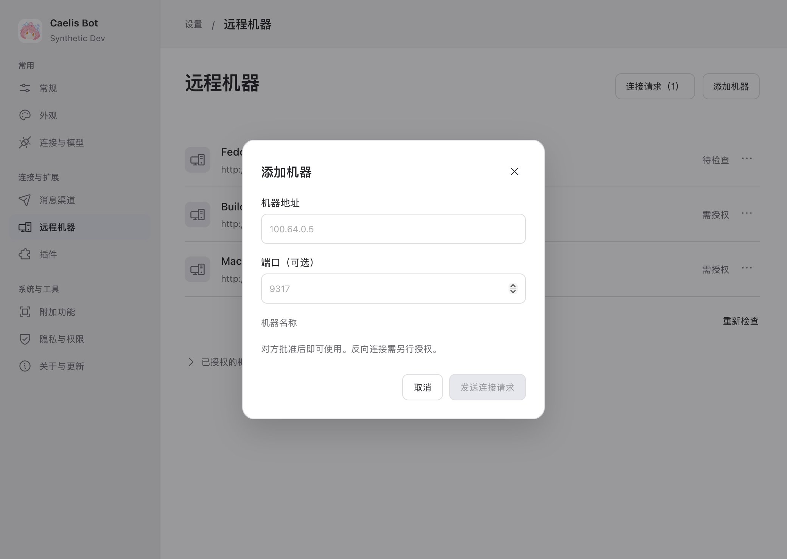
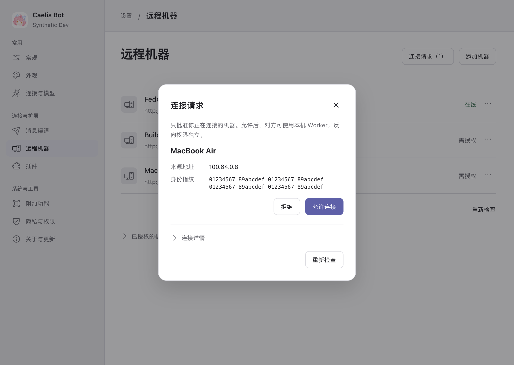

# Remote machines

The default page is a compact list of name, address and actual status, with one
Add machine button. It has no account/server dashboard, tabs, local-sharing switch,
verification-code generation or SSH configuration. The old helper execution path
and its installer, credential handling and UI are removed.

Add asks for an IP/address, optional port and optional local name. Sending returns
as soon as B stores the request; it never holds the UI waiting for approval. Pending
and unknown connections stay in this list but are excluded from task environments
and new-work admission. A reads the original request only on page entry or explicit
Check. Reads have an eight-second bound and page-entry checks have at most three
concurrent requests; leaving cancels the unstarted queue.

B's Connection requests entry shows the self-reported source name, observed source
address and proof-bound fingerprint. Only B's authenticated local settings user may
allow/decline. Names and loopback/SSH source addresses never prove authorization.
Grant plus original request decision are saved atomically in the existing peer
registry. The reverse direction needs its own approval/proof. Source revocation is
in a small collapsed list, and never means stop or approval of a task request.

The inbox is bounded (16 pending, 128 retained request identities); a repeated ID
cannot extend expiry, change content or revive a terminal request. Requests expire
after five minutes without granting access. Reaching capacity refuses only new
remote requests; it neither drops old identities nor affects local work.

A persists its source/proof/intent before delivery and pins B's public instance
identity before the first request write. B rejects a different target identity.
Reads of uncertain delivery use the exact original request, proof and target,
never a later grant or different machine. A proven pre-delivery failure is a safe
refusal; post-delivery loss remains uncertain. No old code/SSH compatibility graph
or migration layer is carried into this first release.

The App owns an independently authenticated peer listener (9317, OS-selected port
on bind conflict). A reachable existing headless listener is reused; a loopback-only
browser listener remains unchanged, with a separate peer-only listener. Actual
address/port appears in the collapsed connection details. No unauthenticated Worker
execution or widening of browser Host/Origin/CSRF trust is introduced.

Readiness errors distinguish missing/unavailable/incompatible Runtime, sign-in or
model-service authorization, absent/unavailable model, unsupported effort/speed,
unreadable local settings, changed settings and bounded timeout. Safe text names
the settings path; raw paths/tokens/native exceptions are never rendered. Caelis'
omitted conversation effort inherits the selected model's structured native default
without changing user settings, explicit choices or retained task bindings.

The user's running Dev and its data are not fixtures. Candidates use separate
output roots. Screenshots below are actual native WKWebView/React with synthetic
settings transport; product execution evidence comes from separate real A/B apps.

