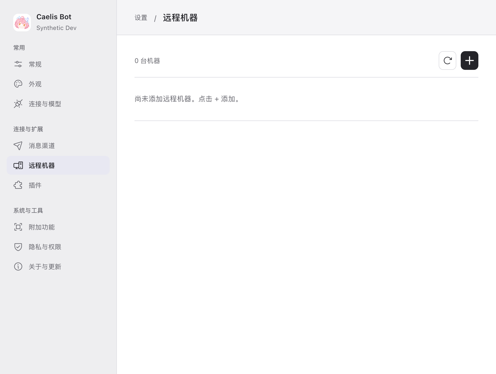
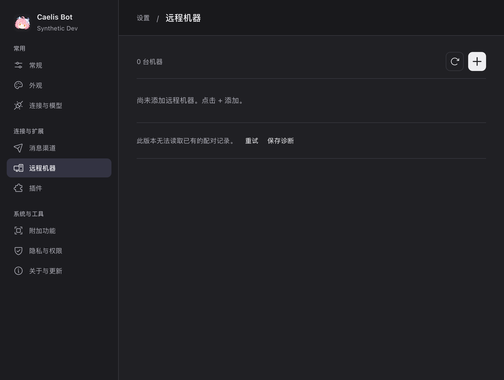

# Remote machines

The existing Settings breadcrumb owns the title. One aligned toolbar shows the
known machine count, Check and a visible **+** Add machine button with a tooltip
and accessible label. A **Pairing requests** bell appears only for pending,
unexpired requests. No hero, repeated large heading, scattered footer actions,
account/server dashboard, sharing switch, verification code or SSH/helper path.

Add is a short dialog: address and a narrow optional port on one row. Empty inputs
have placeholders; “Default 9317” is not a submitted value. The target name is read
from the original peer receipt; an established machine can be renamed in its same
settings dialog. There is no one-field accordion or duplicate name label.

Sending returns after B stores the request, never waits for human approval. Only a
confirmed pending row says “Request delivered; approve it in the other Bot.” An
unknown result only offers checks of its original request; changing its reachable
address uses the existing pinned-peer read boundary. A host-proven undispatched
intent can correct its address and explicitly send the same original intent. A
possible write is never cleared or retried with another ID/proof/owner.

The list distinguishes loading, empty, read failure, pending, unknown, declined,
expired, revoked and native readiness. Failed refresh preserves cached rows and
marks missing freshness. A local one-shot deadline repaints expired readiness and
incoming requests; it performs no network request. Page-entry/manual checks are
bounded, max three concurrent. Pending authorization is never polled in background
or offered for delegation.

B's second dialog shows the self-reported name, observed address and proof-bound
fingerprint, with Decline/Allow. Names and loopback addresses are not identity
proof. Only B's authenticated local user may decide; the reverse direction needs
its own authorization. Handled/expired requests leave the inbox. Source revocation
remains in a collapsed list, changes only its direction and does not stop work.

## Errors and recovery

Read-only `WorkerSharing` reports state; explicit `RefreshWorkerSharing` coalesces
an attempt to reopen the **same** failed registry or prepare a missing listener.
It never reopens a healthy server, changes identity, grants authority or creates a
native owner. App close fences retained handlers and late factories. Local chat,
Workers, health and updates do not wait on this remote feature.

Registry version/permission/unreadable failures are distinct from listener and
Worker-readiness failures. Fixed safe messages offer Retry/diagnostic export;
original native errors, paths, tokens and private JSON are not rendered. A known
sign-in/model/configuration request shows its precise reason and a direct
Connections & Models action on the machine that needs it. Unknown errors do not
invent a configuration change for the user.

The unreleased v1 experiment is not migrated. In the existing isolated Dev, an
empty disabled v1 registry prevented the v2 service from starting; it was **not**
a missing Runtime/login/model/effort. Its one-time cold cleanup belongs to that
Dev upgrade, outside product code. Nonempty, malformed or incompatible state
remains fail-closed, with its contents and original effects preserved.

## Validation

Actual native AppKit/WKWebView screenshots cover light/dark at 1280×900 and 900×680:
empty/list/Add/pending/incoming/unknown/read failure/reception failure/approval
recovery. Data transport is explicitly synthetic; this is native rendering evidence,
not native Runtime or account acceptance. Independent visual review checks all 36
images and rechecks changed error/loading images. Browser acceptance uses actual
React controls and verifies geometry, request entry visibility, no pending polling,
original unknown checks, explicit read recovery and local freshness deadlines.

Use existing cached Chrome/Playwright (no install):

```sh
WORKER_PEER_PLAYWRIGHT_MODULE=/path/to/existing/playwright/index.mjs node script/remote-machines-ui.mjs
BOT_REMOTE_UI_MATRIX=1 BOT_SETTINGS_PREVIEW_ROOT=/private/tmp/owned-preview BOT_SETTINGS_PREVIEW_EVIDENCE=/private/tmp/owned-evidence bash script/desktop-settings-preview.sh
```

Actual A/B HTTP/React application and real installed Codex + isolated Mock MCP
journeys are separate acceptance commands documented in [worker-peer-e2e.md](worker-peer-e2e.md).
The bounded URL contract and its explicit first-version exclusions are unchanged.
No user Dev/formal instance is restarted by the preview or tests. The coordinator
applies the verified candidate to the isolated Dev after receiving the handoff.





