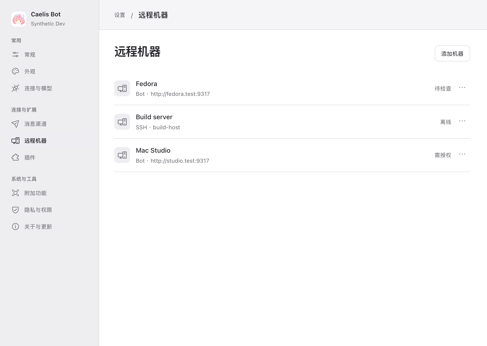
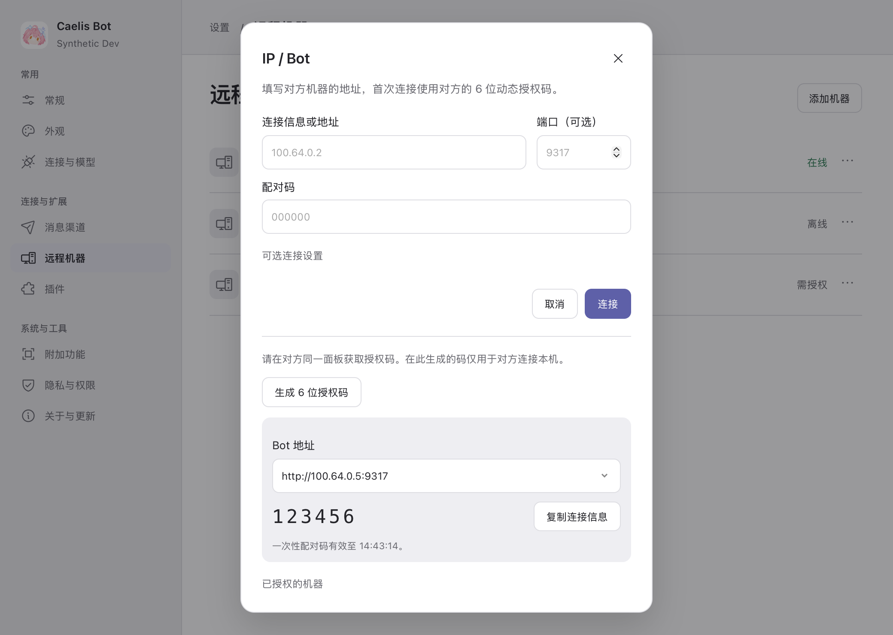
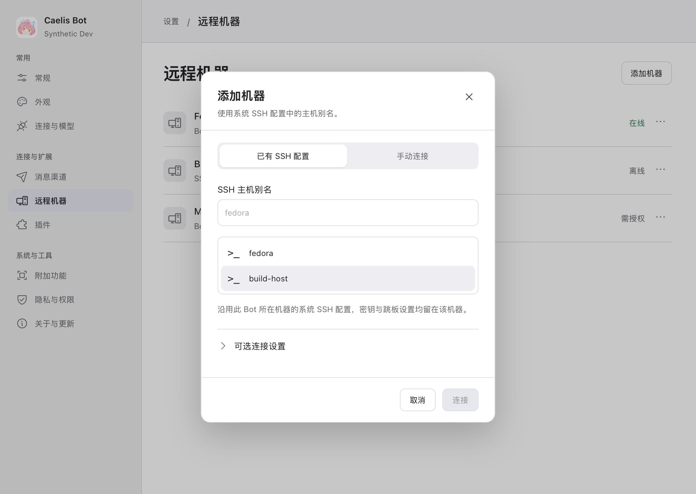

# Remote machines

Settings opens one compact machine list: name, Bot/SSH address, current status and
row actions. Empty state has one sentence and Add. Authorization/native setup and
stale observations are distinct from online; bounded background checks never hold
the shared routing lock across SSH/network calls.

Add has two methods:

- **IP / Bot**: paste connection information, or enter address + optional port
  (bare hosts default to 9317) + the target's six-digit one-time code. The
  authenticated target's machine name is presentation metadata only;
  an explicit local rename wins. It never changes the original pairing intent,
  identity, proof or task owner.
- **SSH**: enter a system Host alias. Literal alias discovery is suggestions;
  OpenSSH interprets Include, Match, ProxyJump/ProxyCommand, identity/trust files.
  New alias connections use system trust with strict host verification. Existing
  app-pinned profiles keep their pins and bindings. Direct address setup remains
  in the top method selector. Host aliases are visible selectable rows and remain
  editable, including aliases absent from the suggestion inventory. The existing Linux helper path and its original
  capabilities remain unchanged; the shared list does not upgrade the helper.

There is no local-sharing tab or global switch. On the target, open the same
**Add machine → IP / Bot** panel and generate/copy its connection information.
Generating a code prepares only the independently authenticated Worker listener;
it never widens the browser/resident listener or grants execution. For a fresh
loopback-only host this explicit action binds a peer-only listener on 9317,
falling back to an OS-selected port only on address-in-use. The actual endpoint
is persisted and included in the copied information. Local network-interface
addresses can be selected; this is publication, not peer discovery or trust.
Loopback remains an explicit option for externally prepared forwarding.

The code uses cryptographic randomness, expires after five minutes, is consumed
once and is invalidated after five wrong guesses. Generating a new code replaces
the unused code. It does not clear an uncertain remote pairing, change its proof,
or replay it. The Web action uses the existing authenticated/CSRF-protected Local
boundary for this replaceable local code, separate from remote pairing receipts.
A not-ready Worker can be corrected and retried without a permanent Web pending
operation. Previously disabled grants remain revoked until explicitly reauthorized
with their original proof; generating a code does not revive them.

Named-source revocation is in the IP panel's authorization details. Tailscale only
supplies the network. A→B and B→A need separate handshakes/proofs; revocation is directional
and is not Stop. Existing unknown pairing recovery remains on its original
operation and profile, with explicit fresh authorization when required.

## Evidence

The screenshot is a real macOS WKWebView using the shared React settings and a
clearly synthetic preview transport. It proves layout, not real SSH/account or
Worker execution. Product acceptance uses separate actual A/B applications,
authenticated HTTP and React, with a controlled native fixture. Its extended
journey checks wrong-code correction, unknown original pairing recovery, two
independent handshakes, one-way revocation/restoration and an existing SSH alias
coexisting without being adopted by a mistyped Bot address. It then covers
attachments, original questions/approvals, output/download, UI Stop and an
offline copied result. Real Codex URL acceptance uses the existing isolated Mock
MCP/controlled model path; no real third-party OAuth/account claim is made.

Native OpenSSH tests use isolated -F/Include files to verify effective multi-hop
ProxyJump and ProxyCommand configuration without connecting or reading/copying
user keys. Fault tests hold SSH inspect/model/configuration/team/terminal calls
while local and another peer Stop reach native control. Independent native-boundary
negative/positive tests cover same-profile concurrent pin publication and restoring
original pins/credentials after a certified unsupported-platform refusal. The native SSH command owns a separate local transport process group; cancellation
stops its ordinary proxy children and bounds pipe draining. It never stops a
remote Worker owner or unrelated local process. The existing 8 MiB response limit
is enforced while reading, with bounded retained diagnostics. Network
or helper-install uncertainty remains unknown; it is never converted to refusal
or success. This batch does not change the bounded URL support contract.

The active user Dev bundle/data directory is not a test fixture. A new candidate
is built in a separate output root; updating/reopening the user's window requires
coordination. No daily service, SSH configuration, account or existing task moves.

## Task dock follow-up

The default dock contains running/uncertain work and recent completed work.
Confirmed `failed`/`rejected` results leave the default watchlist immediately,
including creation rejection with no native binding and a failure observed before
the product's next refresh. Polling and restart cannot reinsert them. History,
failure results and original operation receipts remain queryable; hiding never
stops work or claims completion. `unknown`/`unconfirmed` are not failures and do
not age out on the failure path. Ordinary completed retention remains 30 minutes.

The existing lock is explicit intent. New explicit Pin calls also retain their
display intent separately from automatic creation pins. Existing locked records
remain locked; legacy `pinned: true` alone cannot prove a manual request and does
not keep a failed default card resident. Explicitly pinning a failed history item
can restore it, with the existing retention/lock behavior. This is presentation
metadata in the existing task manager, not another execution authority.
