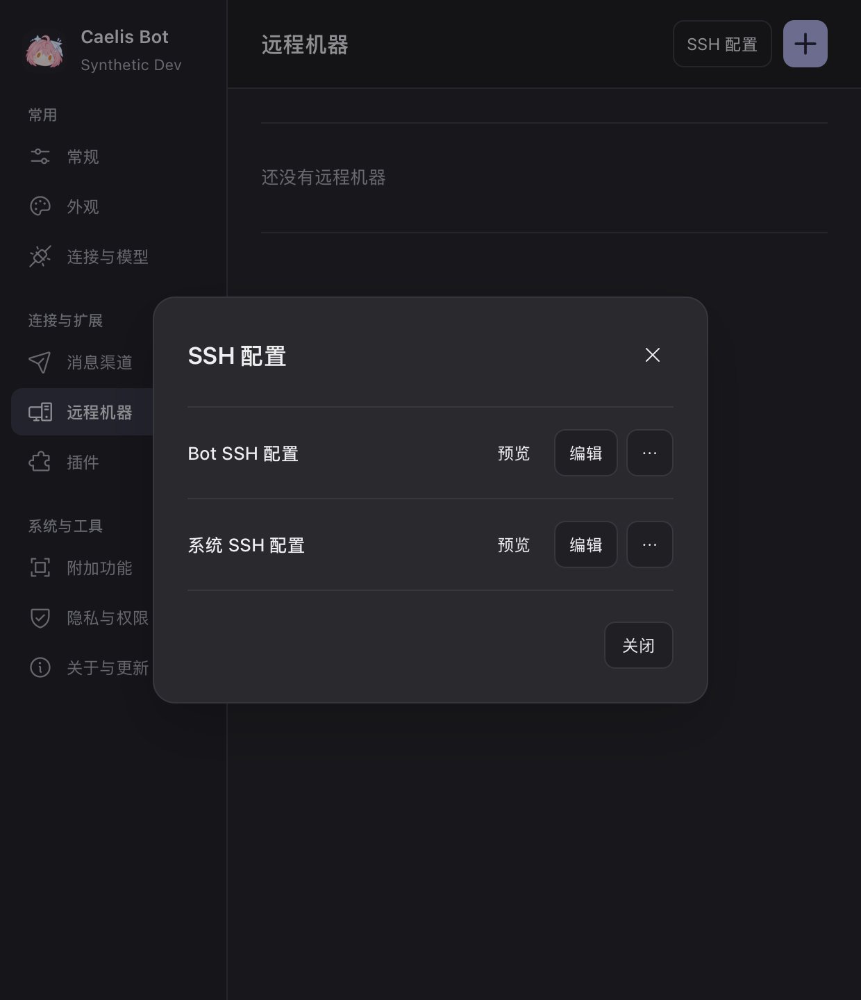

# SSH channels for remote Bots

SSH is a network convenience for the existing Bot-to-Bot environment. It does not
execute work, install helpers, configure remote models, or authorize a source.
Choose Address or SSH in Add machine, search/select a Host alias (or enter one), complete any native SSH
prompt, then send the normal one-way request. The original dialog shows pending
approval only after confirmed delivery, without waiting continuously. B must approve A separately. The
optional UI port is B's Bot port, default 9317, not SSH's login port.

## Configuration authority

The actual editable file is `<Bot data>/Machines/SSH/config` (private directory,
0600/private ACL file). UI and native Bot file tools edit that same standard
OpenSSH file. `bot_tasks {request:{type:"ssh_config"}}` returns its actual path,
revision and literal Host suggestions; it cannot write or authenticate. Keys are never copied. System files are not modified automatically; an explicit
Edit action may open the current user’s `~/.ssh/config` in the native text editor.
The App never opens the administrator’s system-wide configuration for editing.

Invocation precedence is Bot private file, `~/.ssh/config`, then
`/etc/ssh/ssh_config`. First applicable value wins; multiple-valued options retain
OpenSSH semantics. `Host *` resets prevent the last private Host/Match from
accidentally swallowing later layers. System-relative Includes are recursively
mirrored as absolute Includes, retaining conditional positions and lexical order.
No Host/Match/effective-option parser replaces system SSH. ProxyJump, IdentityFile,
agent, User and SSH Port are resolved by SSH. Without User, SSH uses the local OS
login name. A private `-F` alone would drop system configuration, so it is not used
as a replacement for these explicit layers. See the current official
[ssh_config manual](https://man.openbsd.org/ssh_config) and
[ssh options](https://man.openbsd.org/ssh).

The list is an inert, bounded literal-Host index (256 suggestions, 64 files, depth 16, 128 KiB per
file), not an effective configuration claim. Preview never starts SSH. Save uses
content-revision conflict detection, a private temporary file, fsync and atomic
rename; external edits cause a reload requirement. Syntax diagnostics use an
isolated copy with executable Match conditions neutralized, dynamic Includes
omitted, canonicalization/local commands disabled. It cannot certify executable
Match conditions, dynamic includes, credentials, or network reachability. Actual
connection evaluates the original user/private configuration with system SSH.
Erroneously included private-key headers are rejected before full read/mirroring.
FIFOs and other special files are refused with nonblocking open + handle checks.

Current limits are explicit: system-layer Include paths containing `%` or `$`
fail with `ssh_system_include_dynamic`, rather than silently omit or reinterpret
that layer. Use user/private configuration for dynamic paths. Uncommon Host alias
characters outside letters/digits/dot/underscore/hyphen are not accepted by this
network entry. Existing default SSH aliases, literal Includes, ProxyJump and
IdentityFile are covered. The owned mux lifecycle is currently enabled and accepted on macOS/Linux only;
Windows SSH convenience has not been accepted and is disabled. Direct Bot
connections and local Workers remain available on Windows. No Windows SSH GUI
acceptance is claimed.

## Authentication and channel life

Only an explicit Connect opens interactive authentication. A transient askpass
broker presents the original SSH fingerprint/password/passphrase prompt to the
local authenticated App/Web user. Secret values never enter a Web journal, logs,
profile, Notebook or Worker tool. A prompt has one current ID and a two-minute
bound. StrictHostKeyChecking=ask is enforced; a changed host key is not accepted or
removed automatically. ProxyCommand/Match exec are local executable configuration
and run only as part of the requested SSH connection, never preview.

Bot owns a foreground SSH process group and private control socket in a private
system temporary directory (safe for ProxyJump paths). All inherited forwards,
control sharing, background fork, LocalCommand and agent forwarding are disabled.
After that master's authenticated control check, a config-free control command
adds exactly one OS-selected `127.0.0.1` forward to B's loopback Bot port. A successful
TCP probe is insufficient: the owned master's successful forward command is the
readiness evidence. Bind races are retried at most three times. There is no remote
command or generic proxy.

The persisted profile uses `ssh://Host:BotPort`; ephemeral local ports never enter
original pairing proofs/routes. Before sending a proof/token through a new channel,
the public Bot peer identity must match the original pin. Changing SSH files does
not hot-migrate a live channel or any task. Explicit Reconnect SSH starts a new
owned channel and checks the original request/peer. Renaming remains a local
metadata operation, even when SSH/B is offline.

Closing Settings does not stop channels. Remove/disconnect and App close affect
only Bot-owned processes, not a user's terminal SSH or B's native Worker. Automatic
reconnect is batch-only, at most three attempts with 5/10/20+ second spacing;
after that explicit reconnect is required. Interactive startup has two minutes;
ordinary reads wait at most five seconds and respect caller cancellation. At most
16 channels coexist. No global Machines lock covers SSH IO, authentication or
process waits. Unknown Bot writes retain their original IDs/proofs and are read,
never replayed or redirected locally.

## Verification levels

`make e2e-worker-peer-ssh` runs actual isolated A/B applications, production HTTP,
React, a generated-key local sshd and real system OpenSSH. Worker native protocol
is the existing controlled fixture. It verifies browser fingerprint confirmation,
independent Bot grants, task/files/interactions, failure injection and cached
outputs. It is not a real-account or physical cross-machine claim.

`CAELIS_BOT_TEST_SSHD=1 go test -race ./internal/sshtransport` adds opt-in real sshd
acceptance, including ProxyJump and spaced identity paths. Unit tests cover inert
Include/Match preview, original-address reuse, config CAS, special-file refusal,
slow/cancelled transport isolation, and key-header exclusion. React and native
AppKit/WKWebView matrices cover light/dark at large, compact and narrow sizes; their
settings transport is synthetic and is labeled separately from application E2E.

Native AppKit/WKWebView screenshots (synthetic settings transport):

## Daily development data

Normal development launches may select a dedicated persistent data/home through
`<UserConfigDir>/Caelis Bot Dev/active-profile.json`. Release/onboarding do not
read this selector; explicit `CAELIS_BOT_DATA_DIR` test roots always win. The small
file contains only `dataDirectory` and optional `codexHome`, both absolute existing
directories. It is not an account, machine, or execution registry. Invalid selection
fails closed rather than silently adopting a different profile. The private Runtime
home is applied before login-shell environment recovery. Existing data is never
merged automatically. A one-time user-authorized relocation retains the original
files and, when needed, a compatibility path; other profiles stay untouched.
