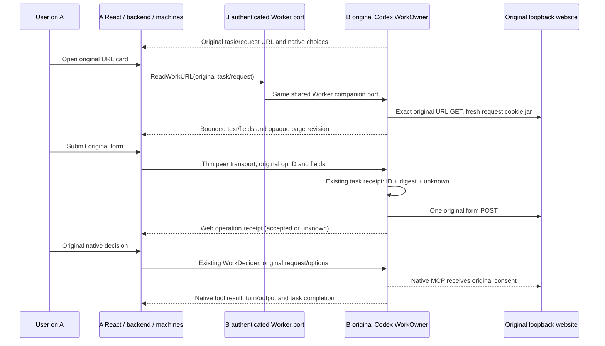

# Original Worker URL forms

This slice completes a **bounded HTTP form** at B's native loopback URL from A's
existing user interaction surface. Native consent still goes to the original
Codex request. This is not arbitrary webpage parity or third-party OAuth
acceptance. Keep #221 draft until the remaining gates pass.

## Authority and transport



`api.WorkURLChallenge` is a companion to `WorkRuntime`. Codex's same Session and
WorkOwner implement it for local and paired routes. `machines.Service` retains
the original task/source route; the peer adds three thin authenticated actions.
A's product task remains in `tasks.Manager`. There is no new executor, approval
state machine, execution ledger or permanent event/page log.

A never supplies a destination URL. B resolves the original task, native request,
client/owner and page revision. The browser binding is transient. ID, intent
digest, original request reference and outcome extend the existing native task
receipt map. No page, entered values, hidden fields or cookies are stored by the
portal. Existing native URL approval evidence remains unchanged and may itself
contain provider-issued URL state. The Web surface delegates receipt ownership
to that adapter rather than persisting a second operation with secret arguments.
Only opaque operation IDs survive a UI reload. Agent/MCP tool permissions do not
grow; this is a user-only desktop/Web port.

HTTP success means only the website accepted that form POST. It does not approve
native work or prove continuation. `serverRequest/resolved` alone is likewise not
completion evidence. A lost HTTP response stays unknown even if the native tool
subsequently completes. Unknown operations are read by their original ID, never
replayed or replaced. An owner/request becoming invalid does not relabel an
uncertain prior effect as rejected. A verified dead owner is never substituted.

## Supported boundary

| Case | Behavior |
| --- | --- |
| Literal IPv4/IPv6 loopback HTTP with explicit port | Read only the original URL; reject the receiving Bot/peer listener port. No DNS expansion, environment proxy, inherited browser profile or forwarded credentials. |
| One static POST form on the exact original path/query | Preserve original field names, explicit option values, hidden state, fresh request-only cookies and offered submit value. Project bounded plain website text; never execute its HTML in A's origin. |
| Text/password/email/tel/url/search, required fields, single select | User enters values in A; hidden state remains B-side. Marked password defaults are not projected. Limits are 64 KiB page/encoded form, 32 named fields and 4096 bytes per entered value. |
| Duplicate original submission | Read original receipt. Different content under that ID is refused. A new ID cannot bypass an accepted/unknown submission for the same request. |
| Decline/cancel, provider expiry, confirmed owner loss | No new submission to an invalid original request; no replacement native owner. Existing unknown receipts remain unknown. |
| Network/UI reconnect with original B owner alive | Restore current original request and receipt; retry reads only. Native consent resolving does not itself revoke an already opened web challenge; terminal facts do. |
| Scripts/event handlers, iframe/embed, redirects, alternate form actions, HTTPS portal, file/multiple/number/textarea fields, extra HTML validation constraints, implicit option IDs | Explicitly outside this slice. No arbitrary target/proxy, callback rewriting, general credential/browser proxy or automatic B-user fallback. Original native request is not falsely declared expired or approved. |
| Public reachable HTTP(S) native URL | Existing original-owner checked browser navigation remains. It is not an OAuth relay. |

The complete same-Runtime local/remote goal still includes native-supported web
flows outside this subset. Rejecting them safely or advertising a capability as
false does not close that goal. Caelis local generic form/URL capability is not
expanded here.

## Reproducible actual application journey

Use an existing installed Codex, Playwright module and Chrome. No runtime,
package, browser or release artifact is downloaded:

```sh
CAELIS_BOT_TEST_CODEX=/absolute/installed/codex \
WORKER_PEER_PLAYWRIGHT_MODULE=/absolute/existing/playwright/index.mjs \
  make e2e-worker-peer-real-url
```

The earlier `script/e2e-worker-peer.sh --url-contract` entry now forwards to this
real-Runtime journey. Its old synthetic gap assertions are historical only.

The command builds the real headless application and React assets and starts A/B
with private HOME/CODEX_HOME/data directories. An isolated native model catalog
and local controlled Responses provider are loaded by **real Codex**. A uses the
native ask policy; the test user approves its original delegation through React.
B's ordinary temporary MCP emits actual `elicitation/create mode=url`. It is not
a synthetic Codex/App Server implementation. Neither user credentials nor daily
MCP configuration is used/copied. This is **real Runtime + mock model/MCP**, not a
real account, third-party OAuth, cross-machine or native-GUI journey.

The executable asserts original task/thread/turn/request/source identity,
original native consent, webpage effect, native tool result/continuation and
at-most-once counts. It covers success, original refusal, duplicate/conflicting
submissions, provider expiry, peer response loss, provider HTTP response loss,
UI reload, verified private native-owner exit and original unknown reconciliation. A never directly submits the B
challenge URL. B's resident product list excludes foreign work. Entered values
are absent from native task bindings. Existing Worker output/history paths
provide completion rather than model prose being treated as a receipt.

Artifacts under ignored `output/playwright/worker-peer-real-url-*` record source
SHA/tree/dirty status, platform, actual Codex version/executable digest, steps,
original IDs, counters, screenshots and cleanup. Development dirty-tree probes
must not be attributed to their base HEAD. Candidate/final SHA evidence is
reported separately. The test terminates only its own Apps/Mock/browser/private
native owners, verifying executable/cwd/PID birth before forced cleanup.

Unit/race regressions additionally cover original owner loss, cross-task scope,
ordinary turn change, hidden-value injection, preserved empty option values,
redirect/control-port/credential-bearing targets, bounded pages, unsupported
script/constraint/readonly/disabled-fieldset/inert-template forms and the absence of a second Web secret journal.

The independent review also covers offline receipt reads through retained routing
and actual host assembly: current resident model/native readiness cannot hide an
original saved receipt. New work still resolves its actual model and readiness.

CI39983328004 at de4b791c passed all selected platforms, including Windows. Earlier
persistence timeout causes remain unproven; no retry, timeout/durability relaxation
or claim of flakiness was used to erase them. Physical machine,
real account/model, native GUI/upgrade, full webpage parity and final whole-PR
independent review are still separate gates.
